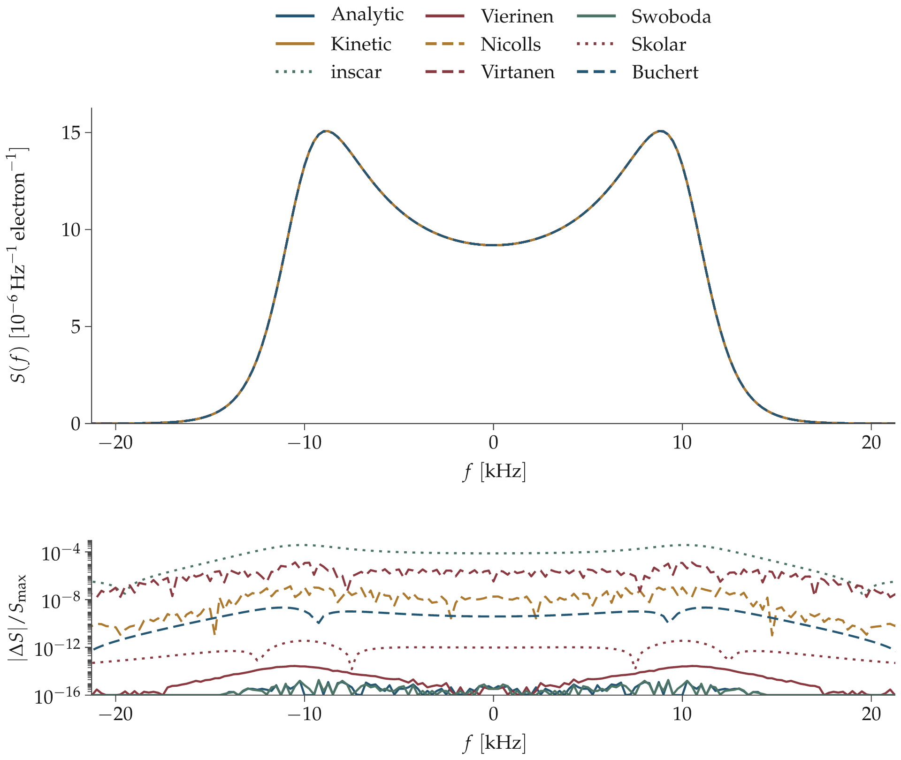
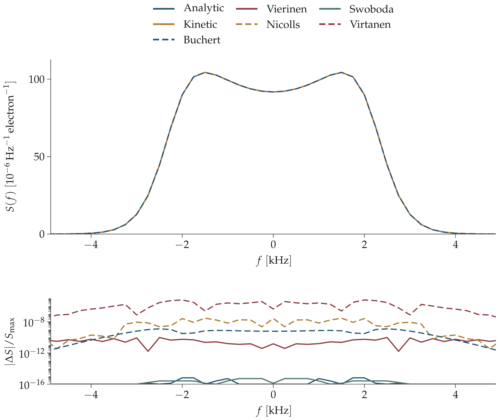
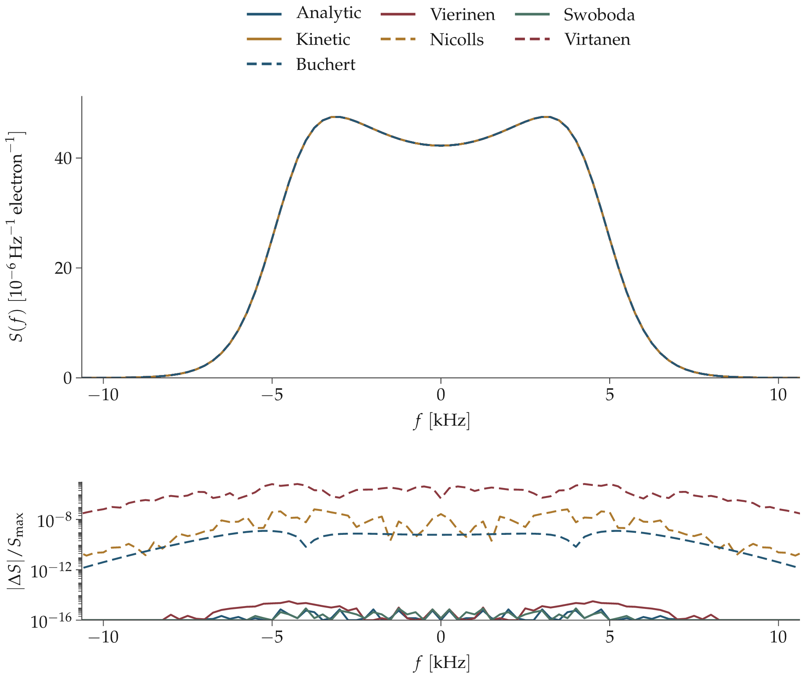
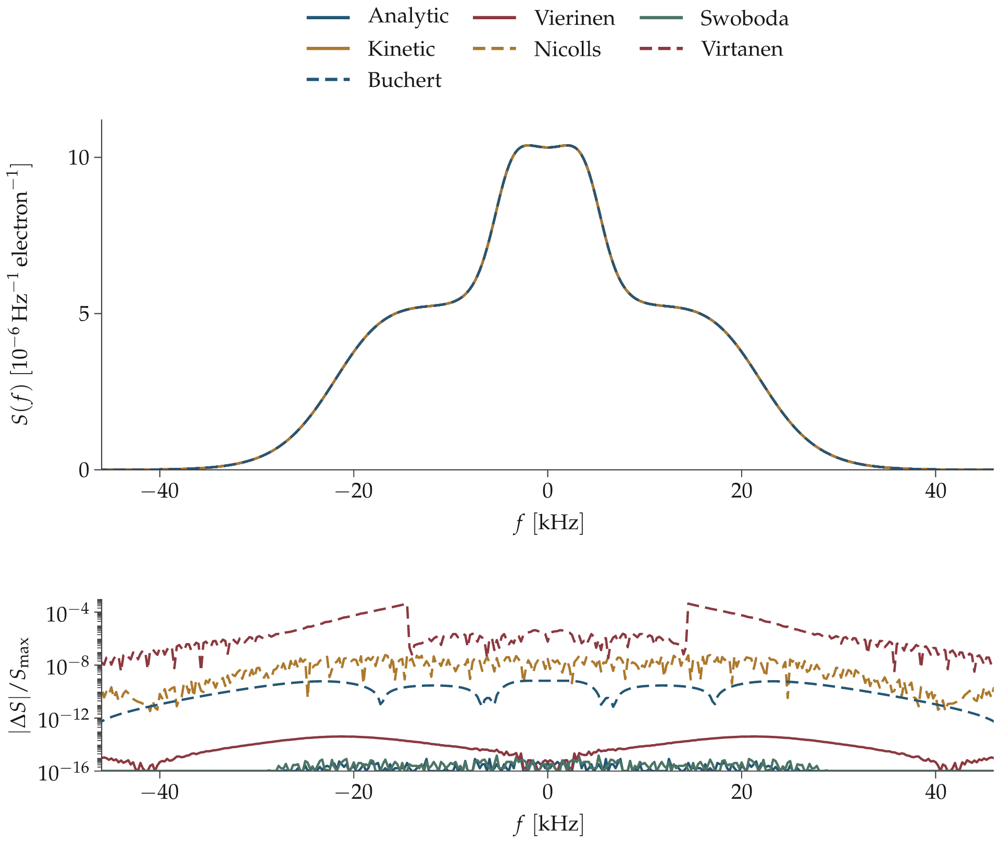
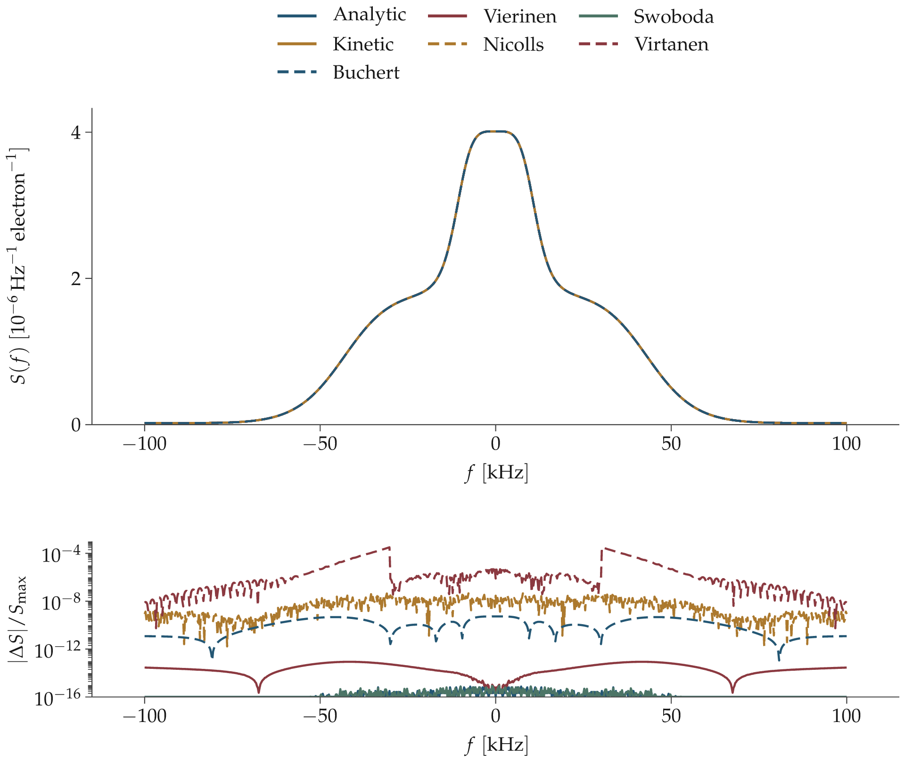

# Unmagnetized ion-line comparisons

🟩 sampled agreement ≤ 10⁻⁶; 🟥 discrepancy > 10⁻⁶. The table metric divides the maximum absolute difference by the larger spectrum peak. No fitted scaling or frequency shifts. See [adapter definitions and limitations](NEW_CODES.md).

## F region, 440.2 MHz

ne = 1e+11 m⁻³; Te = 2000 K; Ti = 1000 K; radar = 440.2 MHz; B = 0 μT; angle(k,B) = 0°; νen = 0 s⁻¹; νin = 0 s⁻¹. Ions: O+: 1 (16 u). All species have zero drift.

Upper panel: absolute spectrum per electron. Lower panel: absolute difference from Kinetic, divided by its peak. Ion-line views focus on the spectral feature; full grids are retained in HDF5. The plasma-line view leaves the unsampled central interval blank. Residuals below 10⁻¹⁶ are clipped to that plotting floor.

| Code | Difference from Kinetic | Refinement change | Symmetry error |
|---|---:|---:|---:|
| Analytic | 🟩 1.80e-15 | — | 🟩 0.00e+00 |
| Vierinen | 🟩 1.03e-14 | — | 🟩 0.00e+00 |
| Swoboda | 🟩 1.44e-15 | — | 🟩 0.00e+00 |
| Kinetic | reference | — | 🟩 0.00e+00 |
| Buchert | 🟩 2.23e-09 | — | 🟩 0.00e+00 |
| Virtanen | 🟥 1.46e-05 | — | 🟩 0.00e+00 |
| Nicolls | 🟩 1.55e-07 | 2.32e-14 | 🟩 3.39e-15 |
| Skolar | 🟩 7.97e-12 | 7.17e-11 | 🟩 0.00e+00 |
| inscar | 🟥 9.81e-05 | 2.69e-08 | 🟩 0.00e+00 |

A dash means no new refinement measurement in this run; it does not establish numerical convergence. A red result is a sampled-spectrum discrepancy, not a diagnosis of its cause. The refinement column compares the two recorded numerical settings. Symmetry compares S(f) and S(−f), which should agree for these stationary cases; it is also measured rather than enforced.

[Spectrum arrays and full pairwise matrix](tables/expanded/f_region_440.2MHz.h5) · [Vector figure](figures/f_region_440.2MHz.svg)

| Unavailable code | Status | Reason |
|---|---|---|
| Martinez | not_run | MATLAB execution cancelled at user request after license failures; no spectrum evaluated. |
| Sandbem | not_run | MATLAB execution cancelled at user request after license failures; no spectrum evaluated. |

## F region, 930 MHz

ne = 1e+11 m⁻³; Te = 2000 K; Ti = 1000 K; radar = 930 MHz; B = 0 μT; angle(k,B) = 0°; νen = 0 s⁻¹; νin = 0 s⁻¹. Ions: O+: 1 (16 u). All species have zero drift.

Upper panel: absolute spectrum per electron. Lower panel: absolute difference from Kinetic, divided by its peak. Ion-line views focus on the spectral feature; full grids are retained in HDF5. The plasma-line view leaves the unsampled central interval blank. Residuals below 10⁻¹⁶ are clipped to that plotting floor.

| Code | Difference from Kinetic | Refinement change | Symmetry error |
|---|---:|---:|---:|
| Analytic | 🟩 1.80e-15 | — | 🟩 0.00e+00 |
| Vierinen | 🟩 2.75e-14 | — | 🟩 0.00e+00 |
| Swoboda | 🟩 1.80e-15 | — | 🟩 0.00e+00 |
| Kinetic | reference | — | 🟩 0.00e+00 |
| Buchert | 🟩 2.16e-09 | — | 🟩 0.00e+00 |
| Virtanen | 🟥 1.31e-05 | — | 🟩 0.00e+00 |
| Nicolls | 🟩 1.32e-07 | 1.31e-14 | 🟩 3.29e-18 |
| Skolar | 🟩 3.59e-12 | 3.23e-11 | 🟩 0.00e+00 |
| inscar | 🟥 3.74e-04 | 2.37e-08 | 🟩 0.00e+00 |

A dash means no new refinement measurement in this run; it does not establish numerical convergence. A red result is a sampled-spectrum discrepancy, not a diagnosis of its cause. The refinement column compares the two recorded numerical settings. Symmetry compares S(f) and S(−f), which should agree for these stationary cases; it is also measured rather than enforced.

[Spectrum arrays and full pairwise matrix](tables/expanded/f_region_930MHz.h5) · [Vector figure](figures/f_region_930MHz.svg)

| Unavailable code | Status | Reason |
|---|---|---|
| Martinez | not_run | MATLAB execution cancelled at user request after license failures; no spectrum evaluated. |
| Sandbem | not_run | MATLAB execution cancelled at user request after license failures; no spectrum evaluated. |

## Molecular ions, 440.2 MHz

ne = 1e+11 m⁻³; Te = 500 K; Ti = 500 K; radar = 440.2 MHz; B = 0 μT; angle(k,B) = 0°; νen = 0 s⁻¹; νin = 0 s⁻¹. Ions: O2+: 0.5 (32 u), NO+: 0.3 (30 u), N2+: 0.2 (28 u). All species have zero drift.

Upper panel: absolute spectrum per electron. Lower panel: absolute difference from Kinetic, divided by its peak. Ion-line views focus on the spectral feature; full grids are retained in HDF5. The plasma-line view leaves the unsampled central interval blank. Residuals below 10⁻¹⁶ are clipped to that plotting floor.

| Code | Difference from Kinetic | Refinement change | Symmetry error |
|---|---:|---:|---:|
| Analytic | 🟩 6.49e-16 | — | 🟩 0.00e+00 |
| Vierinen | 🟩 9.58e-11 | — | 🟩 0.00e+00 |
| Swoboda | 🟩 5.19e-16 | — | 🟩 0.00e+00 |
| Kinetic | reference | — | 🟩 0.00e+00 |
| Buchert | 🟩 1.24e-09 | — | 🟩 0.00e+00 |
| Virtanen | 🟥 6.30e-06 | — | 🟩 0.00e+00 |
| Nicolls | 🟩 2.90e-08 | 1.45e-14 | 🟩 7.92e-15 |

A dash means no new refinement measurement in this run; it does not establish numerical convergence. A red result is a sampled-spectrum discrepancy, not a diagnosis of its cause. The refinement column compares the two recorded numerical settings. Symmetry compares S(f) and S(−f), which should agree for these stationary cases; it is also measured rather than enforced.

[Spectrum arrays and full pairwise matrix](tables/expanded/molecular_440.2MHz.h5) · [Vector figure](figures/molecular_440.2MHz.svg)

| Unavailable code | Status | Reason |
|---|---|---|
| Martinez | not_run | MATLAB execution cancelled at user request after license failures; no spectrum evaluated. |
| Sandbem | not_run | MATLAB execution cancelled at user request after license failures; no spectrum evaluated. |
| Skolar | unsupported | Native calcSpectra supports one ion species only. |
| inscar | unsupported | Native SpectrumCalculation supports one ion species only. |

## Molecular ions, 930 MHz

ne = 1e+11 m⁻³; Te = 500 K; Ti = 500 K; radar = 930 MHz; B = 0 μT; angle(k,B) = 0°; νen = 0 s⁻¹; νin = 0 s⁻¹. Ions: O2+: 0.5 (32 u), NO+: 0.3 (30 u), N2+: 0.2 (28 u). All species have zero drift.

Upper panel: absolute spectrum per electron. Lower panel: absolute difference from Kinetic, divided by its peak. Ion-line views focus on the spectral feature; full grids are retained in HDF5. The plasma-line view leaves the unsampled central interval blank. Residuals below 10⁻¹⁶ are clipped to that plotting floor.

| Code | Difference from Kinetic | Refinement change | Symmetry error |
|---|---:|---:|---:|
| Analytic | 🟩 7.13e-16 | — | 🟩 0.00e+00 |
| Vierinen | 🟩 3.14e-15 | — | 🟩 0.00e+00 |
| Swoboda | 🟩 8.56e-16 | — | 🟩 0.00e+00 |
| Kinetic | reference | — | 🟩 0.00e+00 |
| Buchert | 🟩 1.24e-09 | — | 🟩 0.00e+00 |
| Virtanen | 🟥 6.55e-06 | — | 🟩 0.00e+00 |
| Nicolls | 🟩 6.34e-08 | 1.05e-14 | 🟩 5.07e-15 |

A dash means no new refinement measurement in this run; it does not establish numerical convergence. A red result is a sampled-spectrum discrepancy, not a diagnosis of its cause. The refinement column compares the two recorded numerical settings. Symmetry compares S(f) and S(−f), which should agree for these stationary cases; it is also measured rather than enforced.

[Spectrum arrays and full pairwise matrix](tables/expanded/molecular_930MHz.h5) · [Vector figure](figures/molecular_930MHz.svg)

| Unavailable code | Status | Reason |
|---|---|---|
| Martinez | not_run | MATLAB execution cancelled at user request after license failures; no spectrum evaluated. |
| Sandbem | not_run | MATLAB execution cancelled at user request after license failures; no spectrum evaluated. |
| Skolar | unsupported | Native calcSpectra supports one ion species only. |
| inscar | unsupported | Native SpectrumCalculation supports one ion species only. |

## Topside, 440.2 MHz

ne = 5e+10 m⁻³; Te = 3000 K; Ti = 1500 K; radar = 440.2 MHz; B = 0 μT; angle(k,B) = 0°; νen = 0 s⁻¹; νin = 0 s⁻¹. Ions: O+: 0.5 (16 u), H+: 0.5 (1 u). All species have zero drift.

Upper panel: absolute spectrum per electron. Lower panel: absolute difference from Kinetic, divided by its peak. Ion-line views focus on the spectral feature; full grids are retained in HDF5. The plasma-line view leaves the unsampled central interval blank. Residuals below 10⁻¹⁶ are clipped to that plotting floor.

| Code | Difference from Kinetic | Refinement change | Symmetry error |
|---|---:|---:|---:|
| Analytic | 🟩 1.14e-15 | — | 🟩 0.00e+00 |
| Vierinen | 🟩 4.09e-14 | — | 🟩 0.00e+00 |
| Swoboda | 🟩 1.47e-15 | — | 🟩 0.00e+00 |
| Kinetic | reference | — | 🟩 0.00e+00 |
| Buchert | 🟩 6.60e-10 | — | 🟩 0.00e+00 |
| Virtanen | 🟥 4.39e-04 | — | 🟩 0.00e+00 |
| Nicolls | 🟩 5.78e-08 | 2.31e-14 | 🟩 2.16e-14 |

A dash means no new refinement measurement in this run; it does not establish numerical convergence. A red result is a sampled-spectrum discrepancy, not a diagnosis of its cause. The refinement column compares the two recorded numerical settings. Symmetry compares S(f) and S(−f), which should agree for these stationary cases; it is also measured rather than enforced.

[Spectrum arrays and full pairwise matrix](tables/expanded/topside_440.2MHz.h5) · [Vector figure](figures/topside_440.2MHz.svg)

| Unavailable code | Status | Reason |
|---|---|---|
| Martinez | not_run | MATLAB execution cancelled at user request after license failures; no spectrum evaluated. |
| Sandbem | not_run | MATLAB execution cancelled at user request after license failures; no spectrum evaluated. |
| Skolar | unsupported | Native calcSpectra supports one ion species only. |
| inscar | unsupported | Native SpectrumCalculation supports one ion species only. |

## Topside, 930 MHz

ne = 5e+10 m⁻³; Te = 3000 K; Ti = 1500 K; radar = 930 MHz; B = 0 μT; angle(k,B) = 0°; νen = 0 s⁻¹; νin = 0 s⁻¹. Ions: O+: 0.5 (16 u), H+: 0.5 (1 u). All species have zero drift.

Upper panel: absolute spectrum per electron. Lower panel: absolute difference from Kinetic, divided by its peak. Ion-line views focus on the spectral feature; full grids are retained in HDF5. The plasma-line view leaves the unsampled central interval blank. Residuals below 10⁻¹⁶ are clipped to that plotting floor.

| Code | Difference from Kinetic | Refinement change | Symmetry error |
|---|---:|---:|---:|
| Analytic | 🟩 7.39e-16 | — | 🟩 0.00e+00 |
| Vierinen | 🟩 8.65e-14 | — | 🟩 0.00e+00 |
| Swoboda | 🟩 8.45e-16 | — | 🟩 0.00e+00 |
| Kinetic | reference | — | 🟩 0.00e+00 |
| Buchert | 🟩 5.36e-10 | — | 🟩 0.00e+00 |
| Virtanen | 🟥 3.18e-04 | — | 🟩 0.00e+00 |
| Nicolls | 🟩 4.53e-08 | 1.15e-14 | 🟩 1.70e-16 |

A dash means no new refinement measurement in this run; it does not establish numerical convergence. A red result is a sampled-spectrum discrepancy, not a diagnosis of its cause. The refinement column compares the two recorded numerical settings. Symmetry compares S(f) and S(−f), which should agree for these stationary cases; it is also measured rather than enforced.

[Spectrum arrays and full pairwise matrix](tables/expanded/topside_930MHz.h5) · [Vector figure](figures/topside_930MHz.svg)

| Unavailable code | Status | Reason |
|---|---|---|
| Martinez | not_run | MATLAB execution cancelled at user request after license failures; no spectrum evaluated. |
| Sandbem | not_run | MATLAB execution cancelled at user request after license failures; no spectrum evaluated. |
| Skolar | unsupported | Native calcSpectra supports one ion species only. |
| inscar | unsupported | Native SpectrumCalculation supports one ion species only. |
