# Unmagnetized ion-line comparisons

🟩 sampled agreement ≤ 10⁻⁶; 🟥 discrepancy > 10⁻⁶. The table metric divides the maximum absolute difference by the larger spectrum peak. No fitted scaling or frequency shifts. See [adapter definitions and limitations](NEW_CODES.md).

## F region, 440.2 MHz

ne = 1e+11 m⁻³; Te = 2000 K; Ti = 1000 K; radar = 440.2 MHz; B = 0 μT; angle(k,B) = 0°; νen = 0 s⁻¹; νin = 0 s⁻¹. Ions: O+: 1 (16 u). All species have zero drift.

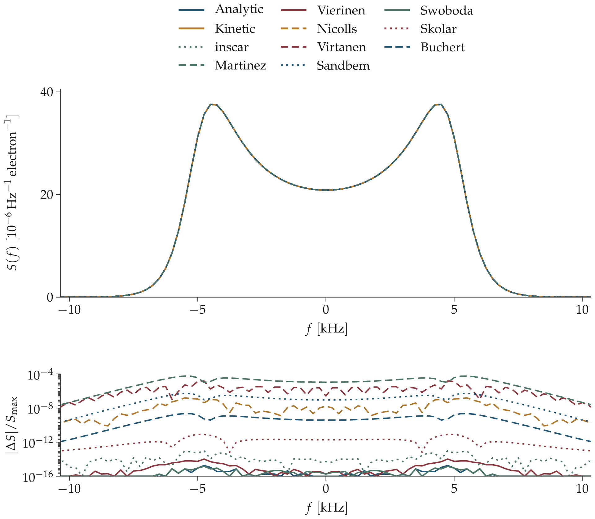

Upper panel: absolute spectrum per electron. Lower panel: absolute difference from Kinetic, divided by its peak. Ion-line views focus on the spectral feature; full grids are retained in HDF5. The plasma-line view leaves the unsampled central interval blank. Residuals below 10⁻¹⁶ are clipped to that plotting floor.

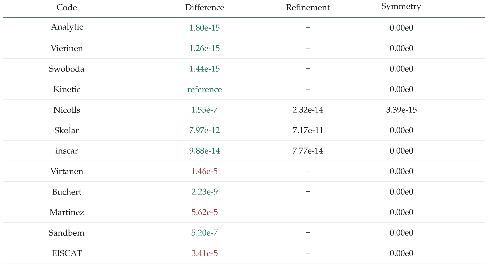

A dash means no new refinement measurement in this run; it does not establish numerical convergence. A red result is a sampled-spectrum discrepancy, not a diagnosis of its cause. The refinement column compares the two recorded numerical settings. Symmetry compares S(f) and S(−f), which should agree for these stationary cases; it is also measured rather than enforced.

[Spectrum arrays and full pairwise matrix](tables/expanded/f_region_440.2MHz.h5) · [Vector figure](figures/f_region_440.2MHz.svg) · [Vector table](figures/f_region_440.2MHz_table.svg)

inscar independent checks: cutoff refinement 6.87e-14; DC-limit sensitivity 1.97e-14. The grid-refinement measurement is shown above.

## F region, 930 MHz

ne = 1e+11 m⁻³; Te = 2000 K; Ti = 1000 K; radar = 930 MHz; B = 0 μT; angle(k,B) = 0°; νen = 0 s⁻¹; νin = 0 s⁻¹. Ions: O+: 1 (16 u). All species have zero drift.

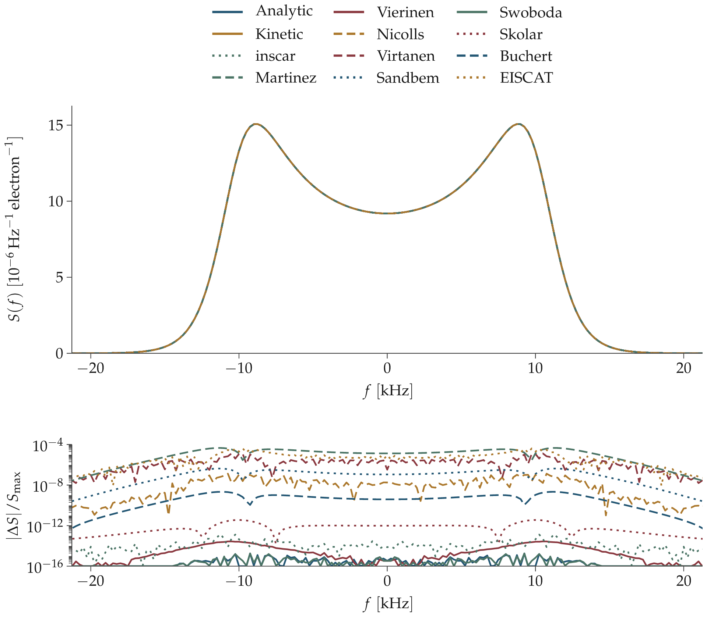

Upper panel: absolute spectrum per electron. Lower panel: absolute difference from Kinetic, divided by its peak. Ion-line views focus on the spectral feature; full grids are retained in HDF5. The plasma-line view leaves the unsampled central interval blank. Residuals below 10⁻¹⁶ are clipped to that plotting floor.

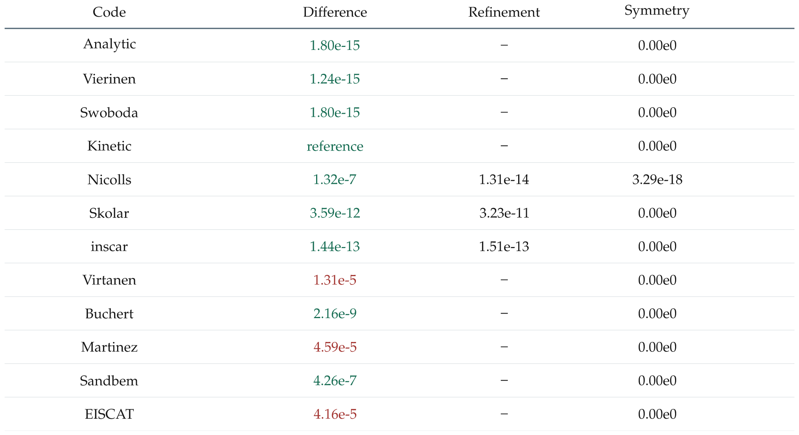

A dash means no new refinement measurement in this run; it does not establish numerical convergence. A red result is a sampled-spectrum discrepancy, not a diagnosis of its cause. The refinement column compares the two recorded numerical settings. Symmetry compares S(f) and S(−f), which should agree for these stationary cases; it is also measured rather than enforced.

[Spectrum arrays and full pairwise matrix](tables/expanded/f_region_930MHz.h5) · [Vector figure](figures/f_region_930MHz.svg) · [Vector table](figures/f_region_930MHz_table.svg)

inscar independent checks: cutoff refinement 7.62e-14; DC-limit sensitivity 4.72e-15. The grid-refinement measurement is shown above.

## Molecular ions, 440.2 MHz

ne = 1e+11 m⁻³; Te = 500 K; Ti = 500 K; radar = 440.2 MHz; B = 0 μT; angle(k,B) = 0°; νen = 0 s⁻¹; νin = 0 s⁻¹. Ions: O2+: 0.5 (32 u), NO+: 0.3 (30 u), N2+: 0.2 (28 u). All species have zero drift.

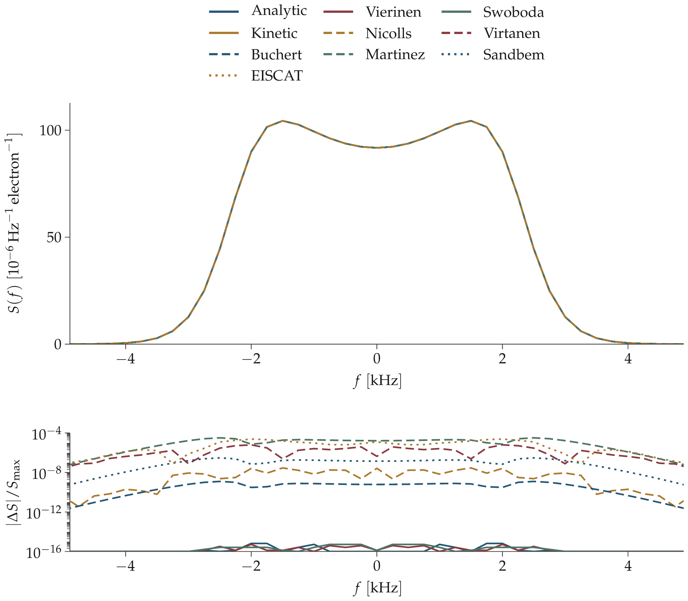

Upper panel: absolute spectrum per electron. Lower panel: absolute difference from Kinetic, divided by its peak. Ion-line views focus on the spectral feature; full grids are retained in HDF5. The plasma-line view leaves the unsampled central interval blank. Residuals below 10⁻¹⁶ are clipped to that plotting floor.

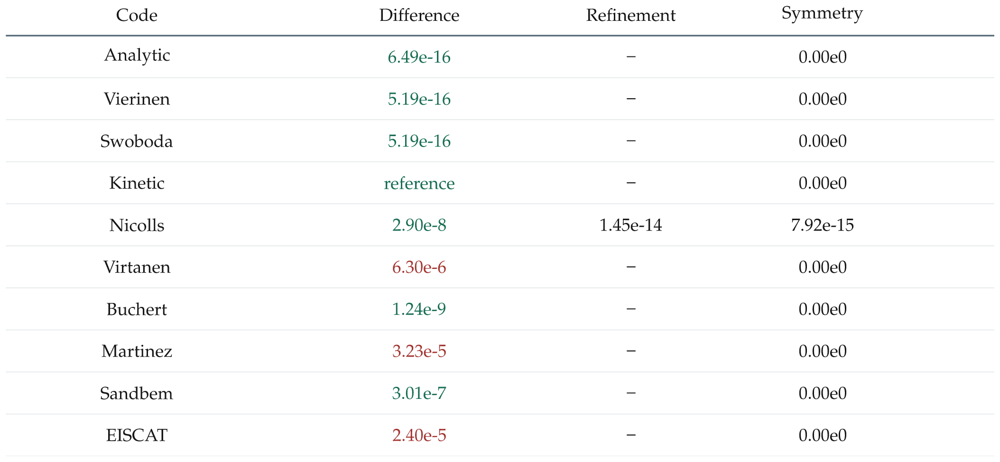

A dash means no new refinement measurement in this run; it does not establish numerical convergence. A red result is a sampled-spectrum discrepancy, not a diagnosis of its cause. The refinement column compares the two recorded numerical settings. Symmetry compares S(f) and S(−f), which should agree for these stationary cases; it is also measured rather than enforced.

[Spectrum arrays and full pairwise matrix](tables/expanded/molecular_440.2MHz.h5) · [Vector figure](figures/molecular_440.2MHz.svg) · [Vector table](figures/molecular_440.2MHz_table.svg)

Skolar: unsupported — Native calcSpectra supports one ion species only..
inscar: unsupported — Native SpectrumCalculation supports one ion species only..

## Molecular ions, 930 MHz

ne = 1e+11 m⁻³; Te = 500 K; Ti = 500 K; radar = 930 MHz; B = 0 μT; angle(k,B) = 0°; νen = 0 s⁻¹; νin = 0 s⁻¹. Ions: O2+: 0.5 (32 u), NO+: 0.3 (30 u), N2+: 0.2 (28 u). All species have zero drift.

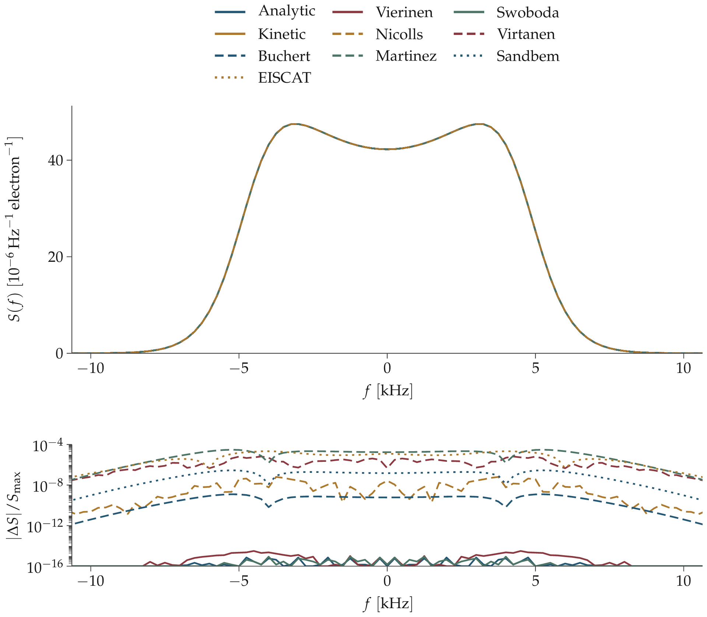

Upper panel: absolute spectrum per electron. Lower panel: absolute difference from Kinetic, divided by its peak. Ion-line views focus on the spectral feature; full grids are retained in HDF5. The plasma-line view leaves the unsampled central interval blank. Residuals below 10⁻¹⁶ are clipped to that plotting floor.

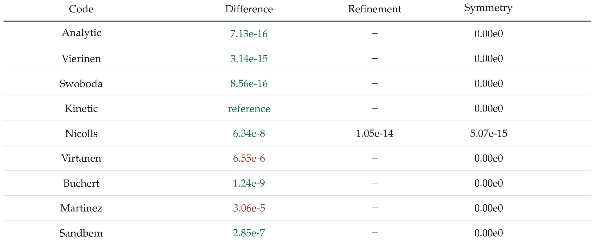

A dash means no new refinement measurement in this run; it does not establish numerical convergence. A red result is a sampled-spectrum discrepancy, not a diagnosis of its cause. The refinement column compares the two recorded numerical settings. Symmetry compares S(f) and S(−f), which should agree for these stationary cases; it is also measured rather than enforced.

[Spectrum arrays and full pairwise matrix](tables/expanded/molecular_930MHz.h5) · [Vector figure](figures/molecular_930MHz.svg) · [Vector table](figures/molecular_930MHz_table.svg)

Skolar: unsupported — Native calcSpectra supports one ion species only..
inscar: unsupported — Native SpectrumCalculation supports one ion species only..

## Topside, 440.2 MHz

ne = 5e+10 m⁻³; Te = 3000 K; Ti = 1500 K; radar = 440.2 MHz; B = 0 μT; angle(k,B) = 0°; νen = 0 s⁻¹; νin = 0 s⁻¹. Ions: O+: 0.5 (16 u), H+: 0.5 (1 u). All species have zero drift.

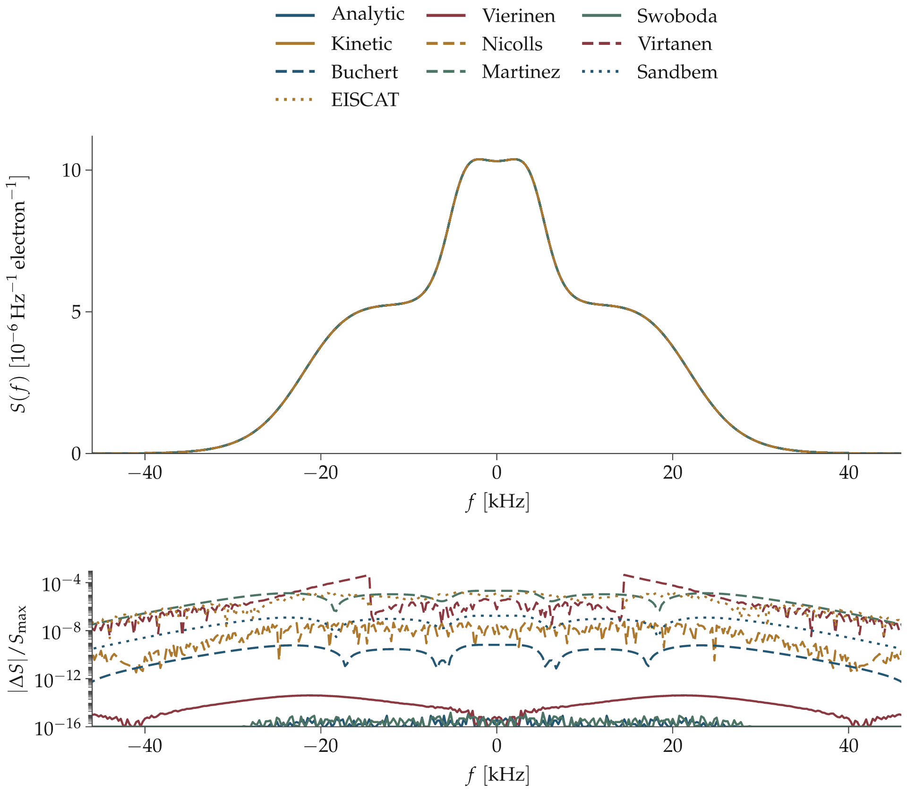

Upper panel: absolute spectrum per electron. Lower panel: absolute difference from Kinetic, divided by its peak. Ion-line views focus on the spectral feature; full grids are retained in HDF5. The plasma-line view leaves the unsampled central interval blank. Residuals below 10⁻¹⁶ are clipped to that plotting floor.

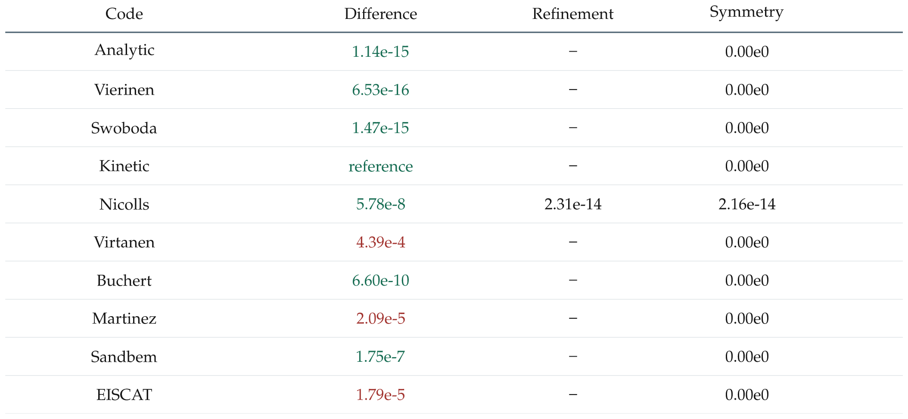

A dash means no new refinement measurement in this run; it does not establish numerical convergence. A red result is a sampled-spectrum discrepancy, not a diagnosis of its cause. The refinement column compares the two recorded numerical settings. Symmetry compares S(f) and S(−f), which should agree for these stationary cases; it is also measured rather than enforced.

[Spectrum arrays and full pairwise matrix](tables/expanded/topside_440.2MHz.h5) · [Vector figure](figures/topside_440.2MHz.svg) · [Vector table](figures/topside_440.2MHz_table.svg)

Skolar: unsupported — Native calcSpectra supports one ion species only..
inscar: unsupported — Native SpectrumCalculation supports one ion species only..

## Topside, 930 MHz

ne = 5e+10 m⁻³; Te = 3000 K; Ti = 1500 K; radar = 930 MHz; B = 0 μT; angle(k,B) = 0°; νen = 0 s⁻¹; νin = 0 s⁻¹. Ions: O+: 0.5 (16 u), H+: 0.5 (1 u). All species have zero drift.

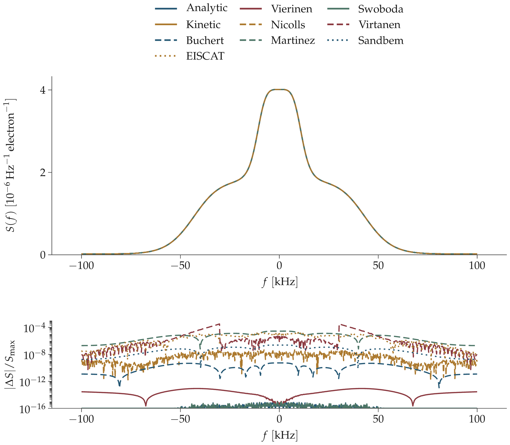

Upper panel: absolute spectrum per electron. Lower panel: absolute difference from Kinetic, divided by its peak. Ion-line views focus on the spectral feature; full grids are retained in HDF5. The plasma-line view leaves the unsampled central interval blank. Residuals below 10⁻¹⁶ are clipped to that plotting floor.

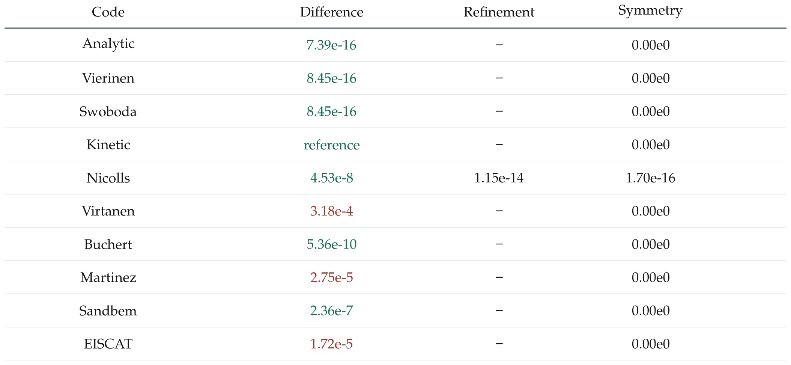

A dash means no new refinement measurement in this run; it does not establish numerical convergence. A red result is a sampled-spectrum discrepancy, not a diagnosis of its cause. The refinement column compares the two recorded numerical settings. Symmetry compares S(f) and S(−f), which should agree for these stationary cases; it is also measured rather than enforced.

[Spectrum arrays and full pairwise matrix](tables/expanded/topside_930MHz.h5) · [Vector figure](figures/topside_930MHz.svg) · [Vector table](figures/topside_930MHz_table.svg)

Skolar: unsupported — Native calcSpectra supports one ion species only..
inscar: unsupported — Native SpectrumCalculation supports one ion species only..
