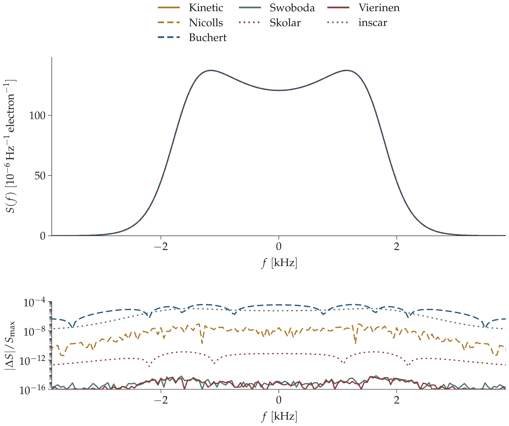
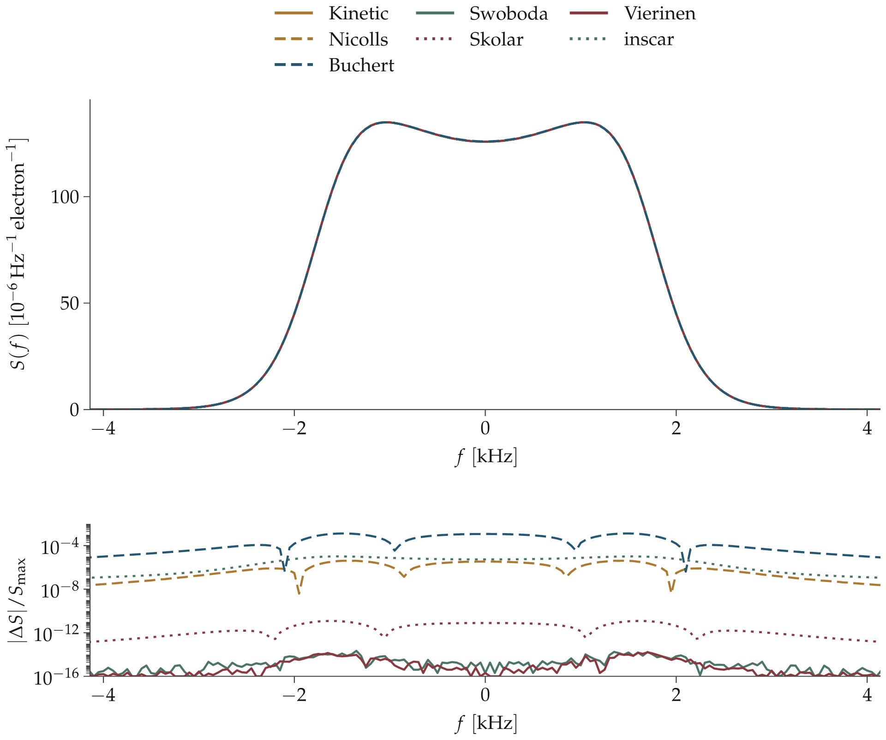
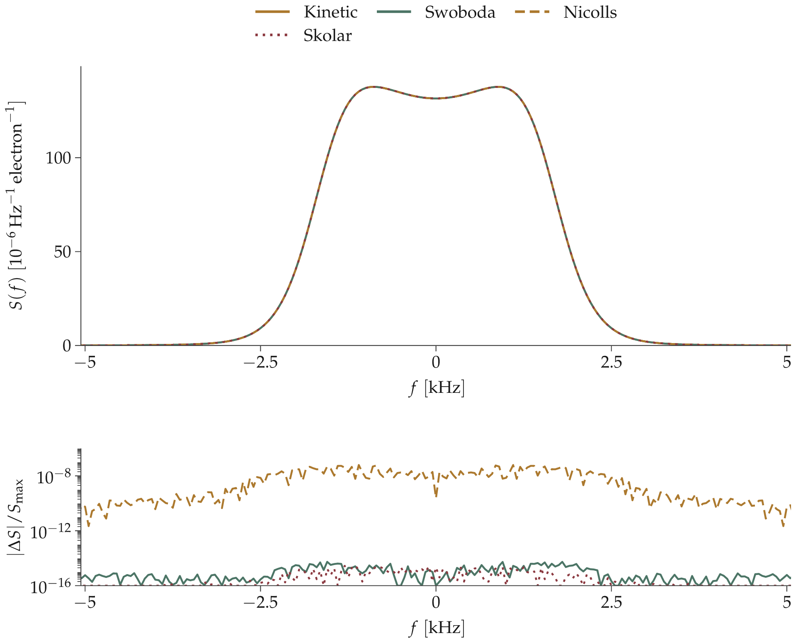
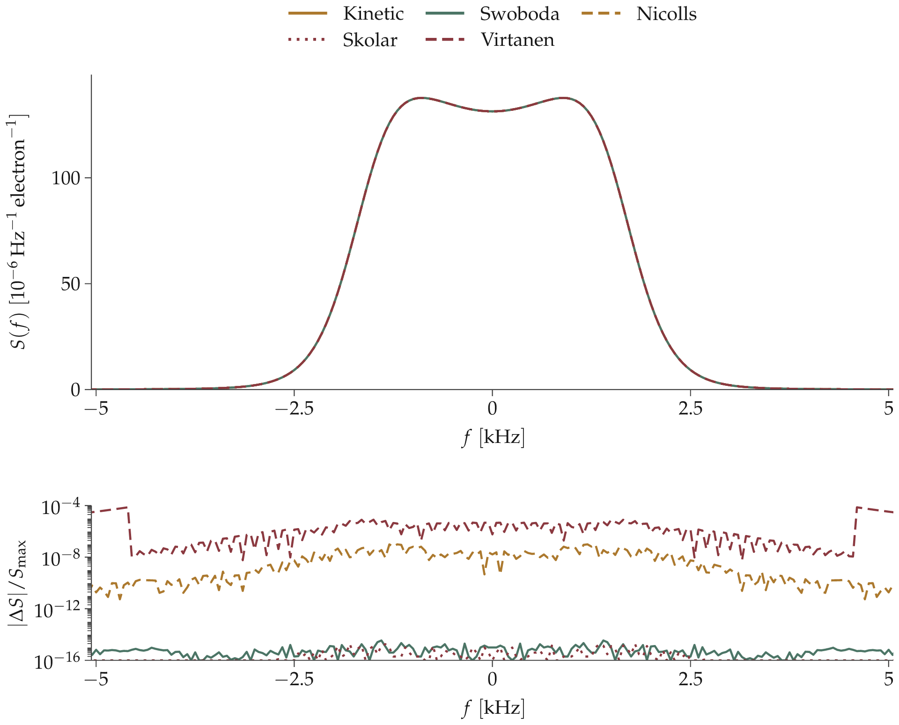
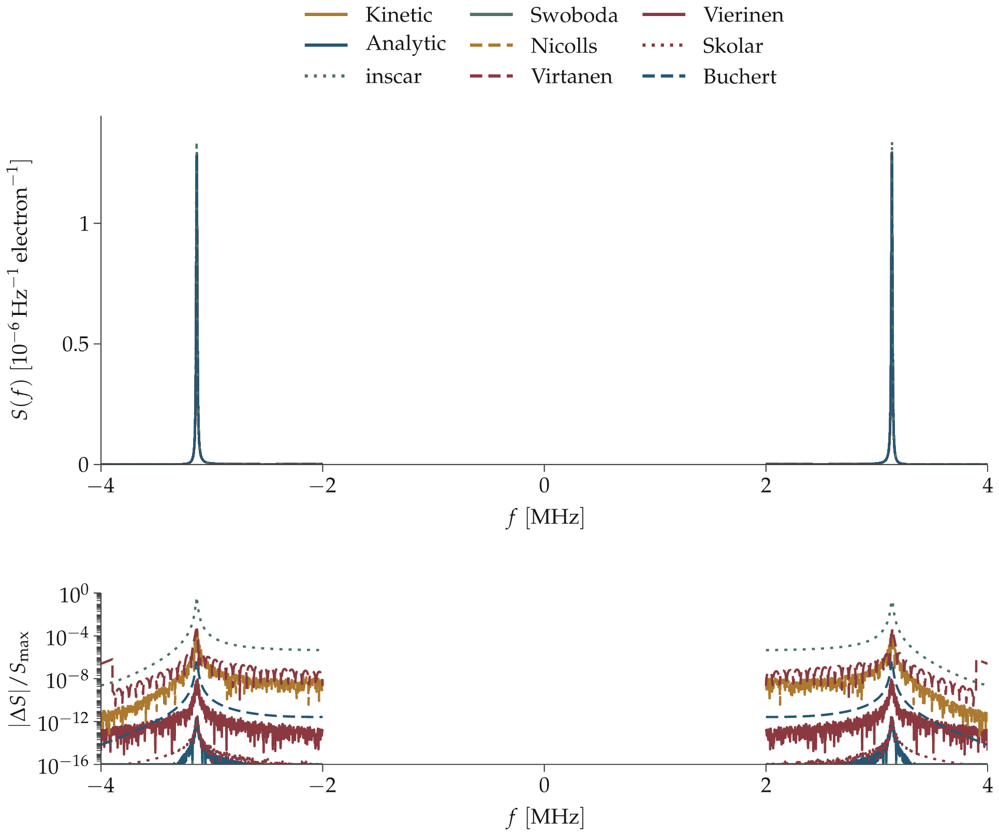

# Magnetic, collision and plasma-line comparisons

🟩 sampled agreement ≤ 10⁻⁶; 🟥 discrepancy > 10⁻⁶. The table metric divides the maximum absolute difference by the larger spectrum peak. No fitted scaling or frequency shifts. See [adapter definitions and limitations](NEW_CODES.md).

## Magnetic field, 42° from B

ne = 1e+11 m⁻³; Te = 300 K; Ti = 300 K; radar = 430 MHz; B = 40 μT; angle(k,B) = 42°; νen = 0 s⁻¹; νin = 0 s⁻¹. Ions: NO+: 1 (30 u). All species have zero drift.

Upper panel: absolute spectrum per electron. Lower panel: absolute difference from Kinetic, divided by its peak. Ion-line views focus on the spectral feature; full grids are retained in HDF5. The plasma-line view leaves the unsampled central interval blank. Residuals below 10⁻¹⁶ are clipped to that plotting floor.

| Code | Difference from Kinetic | Refinement change | Symmetry error |
|---|---:|---:|---:|
| Vierinen | 🟩 5.52e-15 | — | 🟩 0.00e+00 |
| Swoboda | 🟩 7.20e-15 | — | 🟩 0.00e+00 |
| Kinetic | reference | — | 🟩 7.10e-15 |
| Buchert | 🟥 3.87e-05 | — | 🟩 0.00e+00 |
| Nicolls | 🟩 8.74e-08 | 1.02e-14 | 🟩 9.40e-17 |
| Skolar | 🟩 1.33e-11 | 1.19e-10 | 🟩 3.85e-15 |
| inscar | 🟥 1.12e-05 | 1.54e-08 | 🟩 0.00e+00 |

A dash means no new refinement measurement in this run; it does not establish numerical convergence. A red result is a sampled-spectrum discrepancy, not a diagnosis of its cause. The refinement column compares the two recorded numerical settings. Symmetry compares S(f) and S(−f), which should agree for these stationary cases; it is also measured rather than enforced.

[Spectrum arrays and full pairwise matrix](tables/expanded/magnetic_42deg.h5) · [Vector figure](figures/magnetic_42deg.svg)

| Unavailable code | Status | Reason |
|---|---|---|
| Martinez | not_run | MATLAB execution cancelled at user request after license failures; no spectrum evaluated. |
| Sandbem | not_run | MATLAB execution cancelled at user request after license failures; no spectrum evaluated. |
| Virtanen | ['unsupported'] | ['No oblique magnetic response; parallel Maxwellian case is identical to the unmagnetized response.'] |

## Magnetic field, 85° from B

ne = 1e+11 m⁻³; Te = 300 K; Ti = 300 K; radar = 430 MHz; B = 40 μT; angle(k,B) = 85°; νen = 0 s⁻¹; νin = 0 s⁻¹. Ions: NO+: 1 (30 u). All species have zero drift.

Upper panel: absolute spectrum per electron. Lower panel: absolute difference from Kinetic, divided by its peak. Ion-line views focus on the spectral feature; full grids are retained in HDF5. The plasma-line view leaves the unsampled central interval blank. Residuals below 10⁻¹⁶ are clipped to that plotting floor.

| Code | Difference from Kinetic | Refinement change | Symmetry error |
|---|---:|---:|---:|
| Vierinen | 🟩 1.59e-14 | — | 🟩 0.00e+00 |
| Swoboda | 🟩 2.17e-14 | — | 🟩 0.00e+00 |
| Kinetic | reference | — | 🟩 5.82e-15 |
| Buchert | 🟥 1.31e-03 | — | 🟩 0.00e+00 |
| Nicolls | 🟥 4.10e-06 | 1.05e-14 | 🟩 4.30e-17 |
| Skolar | 🟩 1.21e-11 | 1.09e-10 | 🟩 5.42e-15 |
| inscar | 🟥 1.02e-05 | 5.96e-08 | 🟩 0.00e+00 |

A dash means no new refinement measurement in this run; it does not establish numerical convergence. A red result is a sampled-spectrum discrepancy, not a diagnosis of its cause. The refinement column compares the two recorded numerical settings. Symmetry compares S(f) and S(−f), which should agree for these stationary cases; it is also measured rather than enforced.

[Spectrum arrays and full pairwise matrix](tables/expanded/magnetic_85deg.h5) · [Vector figure](figures/magnetic_85deg.svg)

| Unavailable code | Status | Reason |
|---|---|---|
| Martinez | not_run | MATLAB execution cancelled at user request after license failures; no spectrum evaluated. |
| Sandbem | not_run | MATLAB execution cancelled at user request after license failures; no spectrum evaluated. |
| Virtanen | ['unsupported'] | ['No oblique magnetic response; parallel Maxwellian case is identical to the unmagnetized response.'] |

## Neutral BGK collisions, 42° from B

ne = 1e+11 m⁻³; Te = 300 K; Ti = 300 K; radar = 430 MHz; B = 40 μT; angle(k,B) = 42°; νen = 10000 s⁻¹; νin = 1000 s⁻¹. Ions: NO+: 1 (30 u). All species have zero drift.

Upper panel: absolute spectrum per electron. Lower panel: absolute difference from Kinetic, divided by its peak. Ion-line views focus on the spectral feature; full grids are retained in HDF5. The plasma-line view leaves the unsampled central interval blank. Residuals below 10⁻¹⁶ are clipped to that plotting floor.

| Code | Difference from Kinetic | Refinement change | Symmetry error |
|---|---:|---:|---:|
| Swoboda | 🟩 5.41e-15 | — | 🟩 0.00e+00 |
| Kinetic | reference | — | 🟩 3.54e-15 |
| Nicolls | 🟩 6.15e-08 | 2.24e-13 | 🟩 3.75e-22 |
| Skolar | 🟩 2.95e-15 | 0.00e+00 | 🟩 3.15e-15 |

A dash means no new refinement measurement in this run; it does not establish numerical convergence. A red result is a sampled-spectrum discrepancy, not a diagnosis of its cause. The refinement column compares the two recorded numerical settings. Symmetry compares S(f) and S(−f), which should agree for these stationary cases; it is also measured rather than enforced.

[Spectrum arrays and full pairwise matrix](tables/expanded/neutral_bgk_42deg.h5) · [Vector figure](figures/neutral_bgk_42deg.svg)

| Unavailable code | Status | Reason |
|---|---|---|
| Buchert | unsupported | This interface has no electron-neutral BGK input. |
| Martinez | not_run | MATLAB execution cancelled at user request after license failures; no spectrum evaluated. |
| Sandbem | not_run | MATLAB execution cancelled at user request after license failures; no spectrum evaluated. |
| Virtanen | ['unsupported'] | ['No oblique magnetic response; parallel Maxwellian case is identical to the unmagnetized response.'] |
| inscar | unsupported | The inspected collisional F function is not the number-conserving neutral BGK response tested here. |

## Neutral BGK collisions, parallel to B

ne = 1e+11 m⁻³; Te = 300 K; Ti = 300 K; radar = 430 MHz; B = 40 μT; angle(k,B) = 0°; νen = 10000 s⁻¹; νin = 1000 s⁻¹. Ions: NO+: 1 (30 u). All species have zero drift.

Upper panel: absolute spectrum per electron. Lower panel: absolute difference from Kinetic, divided by its peak. Ion-line views focus on the spectral feature; full grids are retained in HDF5. The plasma-line view leaves the unsampled central interval blank. Residuals below 10⁻¹⁶ are clipped to that plotting floor.

| Code | Difference from Kinetic | Refinement change | Symmetry error |
|---|---:|---:|---:|
| Swoboda | 🟩 4.27e-15 | — | 🟩 0.00e+00 |
| Kinetic | reference | — | 🟩 0.00e+00 |
| Virtanen | 🟥 7.33e-05 | — | 🟩 0.00e+00 |
| Nicolls | 🟩 9.86e-08 | 2.24e-13 | 🟩 0.00e+00 |
| Skolar | 🟩 1.87e-15 | 0.00e+00 | 🟩 0.00e+00 |

A dash means no new refinement measurement in this run; it does not establish numerical convergence. A red result is a sampled-spectrum discrepancy, not a diagnosis of its cause. The refinement column compares the two recorded numerical settings. Symmetry compares S(f) and S(−f), which should agree for these stationary cases; it is also measured rather than enforced.

[Spectrum arrays and full pairwise matrix](tables/expanded/neutral_bgk_parallel.h5) · [Vector figure](figures/neutral_bgk_parallel.svg)

| Unavailable code | Status | Reason |
|---|---|---|
| Buchert | unsupported | This interface has no electron-neutral BGK input. |
| Martinez | not_run | MATLAB execution cancelled at user request after license failures; no spectrum evaluated. |
| Sandbem | not_run | MATLAB execution cancelled at user request after license failures; no spectrum evaluated. |
| inscar | unsupported | The inspected collisional F function is not the number-conserving neutral BGK response tested here. |

## Electron plasma lines

ne = 1e+11 m⁻³; Te = 4000 K; Ti = 1000 K; radar = 430 MHz; B = 0 μT; angle(k,B) = 0°; νen = 0 s⁻¹; νin = 0 s⁻¹. Ions: NO+: 1 (30 u). All species have zero drift.

Upper panel: absolute spectrum per electron. Lower panel: absolute difference from Kinetic, divided by its peak. Ion-line views focus on the spectral feature; full grids are retained in HDF5. The plasma-line view leaves the unsampled central interval blank. Residuals below 10⁻¹⁶ are clipped to that plotting floor.

| Code | Difference from Kinetic | Refinement change | Symmetry error |
|---|---:|---:|---:|
| Analytic | 🟩 2.56e-12 | — | 🟩 0.00e+00 |
| Vierinen | 🟩 8.54e-09 | — | 🟩 0.00e+00 |
| Swoboda | 🟩 2.58e-12 | — | 🟩 0.00e+00 |
| Kinetic | reference | — | 🟩 0.00e+00 |
| Buchert | 🟩 3.42e-07 | — | 🟩 0.00e+00 |
| Virtanen | 🟥 4.22e-04 | — | 🟩 0.00e+00 |
| Nicolls | 🟥 3.41e-04 | 9.68e-07 | 🟥 1.75e-06 |
| Skolar | 🟩 3.68e-12 | 1.32e-11 | 🟩 0.00e+00 |
| inscar | 🟥 1.93e-01 | 7.07e-04 (unresolved) | 🟩 0.00e+00 |

A dash means no new refinement measurement in this run; it does not establish numerical convergence. A red result is a sampled-spectrum discrepancy, not a diagnosis of its cause. The refinement column compares the two recorded numerical settings. Symmetry compares S(f) and S(−f), which should agree for these stationary cases; it is also measured rather than enforced.

[Spectrum arrays and full pairwise matrix](tables/expanded/plasma_lines.h5) · [Vector figure](figures/plasma_lines.svg)

| Unavailable code | Status | Reason |
|---|---|---|
| Martinez | not_run | MATLAB execution cancelled at user request after license failures; no spectrum evaluated. |
| Sandbem | not_run | MATLAB execution cancelled at user request after license failures; no spectrum evaluated. |
