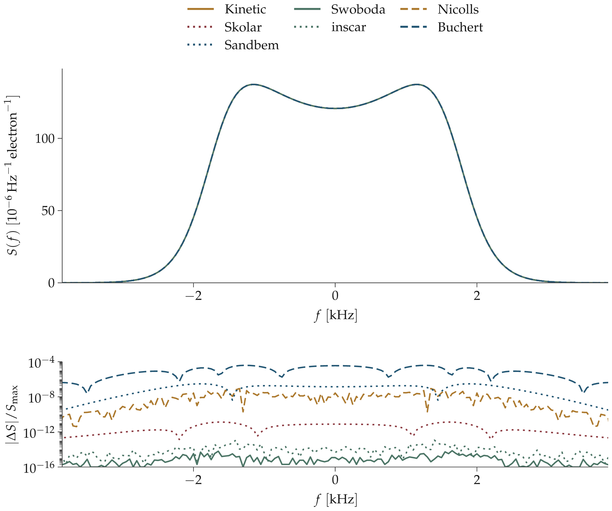
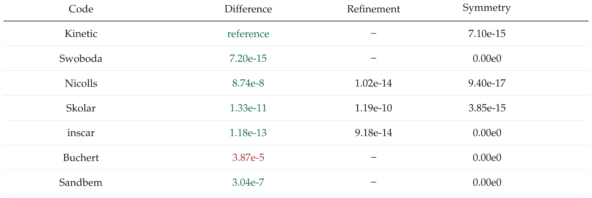
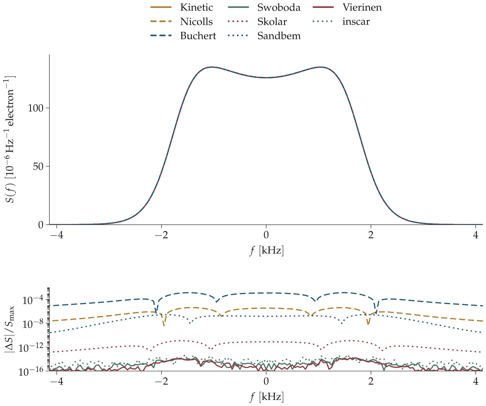
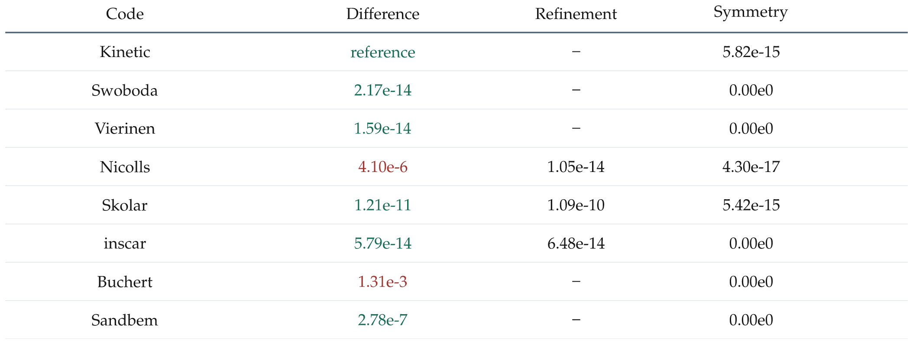
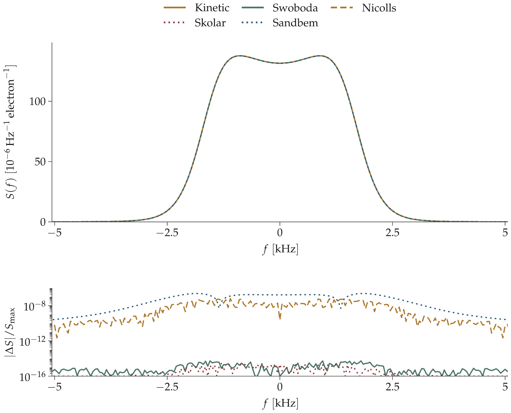
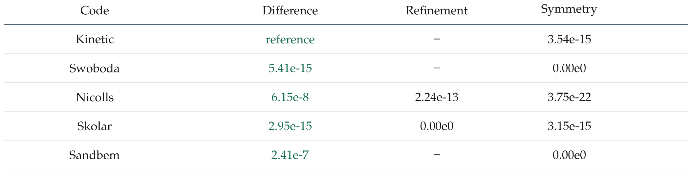
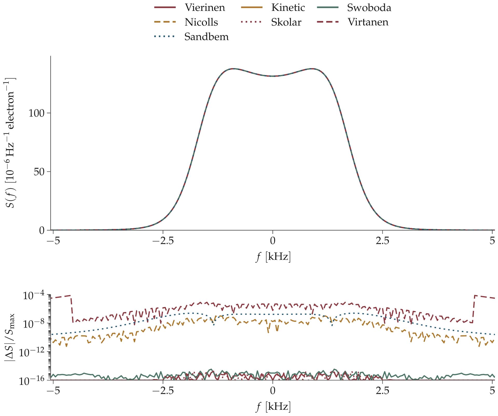
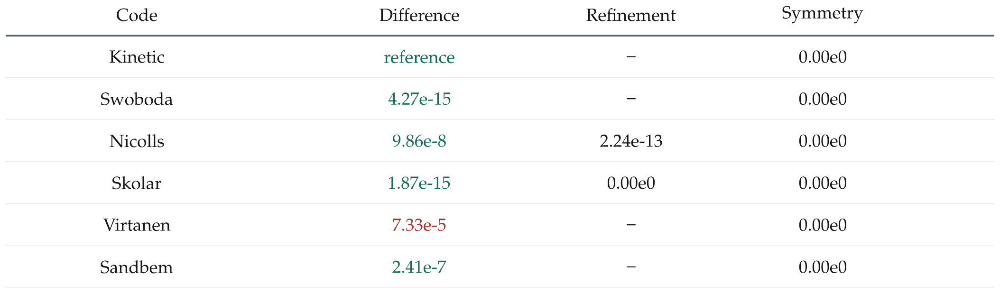
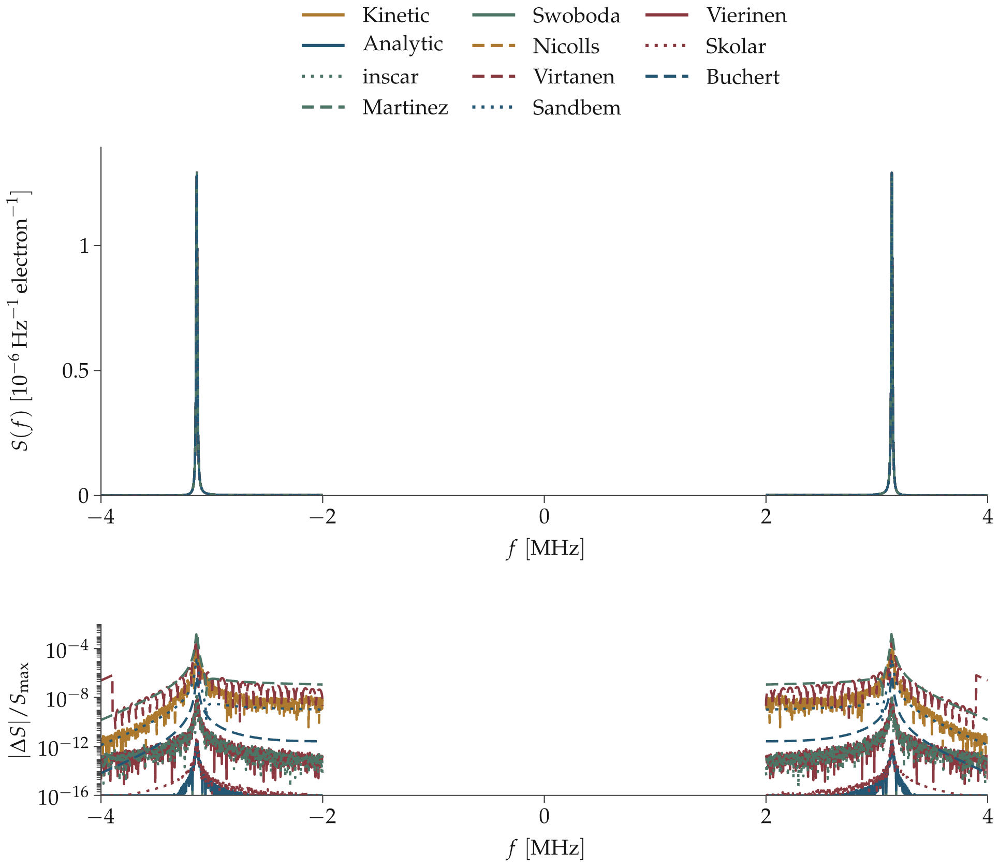
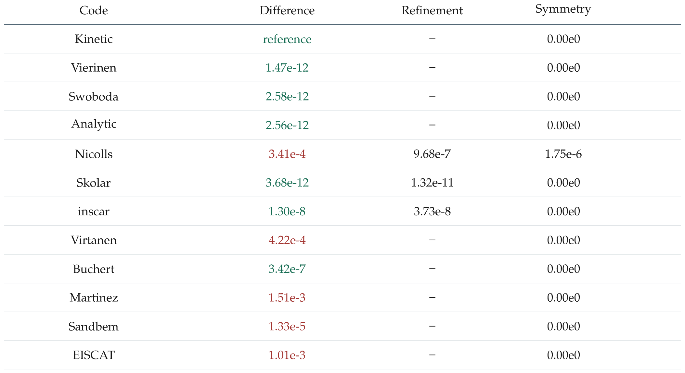

# Magnetic, collision and plasma-line comparisons

🟩 sampled agreement ≤ 10⁻⁶; 🟥 discrepancy > 10⁻⁶. The table metric divides the maximum absolute difference by the larger spectrum peak. No fitted scaling or frequency shifts. See [adapter definitions and limitations](NEW_CODES.md).

## Magnetic field, 42° from B

ne = 1e+11 m⁻³; Te = 300 K; Ti = 300 K; radar = 430 MHz; B = 40 μT; angle(k,B) = 42°; νen = 0 s⁻¹; νin = 0 s⁻¹. Ions: NO+: 1 (30 u). All species have zero drift.

Upper panel: absolute spectrum per electron. Lower panel: absolute difference from Kinetic, divided by its peak. Ion-line views focus on the spectral feature; full grids are retained in HDF5. The plasma-line view leaves the unsampled central interval blank. Residuals below 10⁻¹⁶ are clipped to that plotting floor.

A dash means no new refinement measurement in this run; it does not establish numerical convergence. A red result is a sampled-spectrum discrepancy, not a diagnosis of its cause. The refinement column compares the two recorded numerical settings. Symmetry compares S(f) and S(−f), which should agree for these stationary cases; it is also measured rather than enforced.

[Spectrum arrays and full pairwise matrix](tables/expanded/magnetic_42deg.h5) · [Vector figure](figures/magnetic_42deg.svg) · [Vector table](figures/magnetic_42deg_table.svg)

EISCAT: unsupported — EISCAT adapter evaluated collisionless unmagnetized cases only.
Martinez: unsupported — The Octave adapter does not support this case physics.
Vierinen: unsupported — Vierinen Rust supports unmagnetized or parallel Maxwellian spectra and BGK collisions; oblique magnetic cases are not evaluated.
Virtanen: ['unsupported'] — ['No oblique magnetic response; parallel Maxwellian case is identical to the unmagnetized response.'].

inscar independent checks: cutoff refinement 4.36e-14; DC-limit sensitivity 1.34e-13. The grid-refinement measurement is shown above.

## Magnetic field, 85° from B

ne = 1e+11 m⁻³; Te = 300 K; Ti = 300 K; radar = 430 MHz; B = 40 μT; angle(k,B) = 85°; νen = 0 s⁻¹; νin = 0 s⁻¹. Ions: NO+: 1 (30 u). All species have zero drift.

Upper panel: absolute spectrum per electron. Lower panel: absolute difference from Kinetic, divided by its peak. Ion-line views focus on the spectral feature; full grids are retained in HDF5. The plasma-line view leaves the unsampled central interval blank. Residuals below 10⁻¹⁶ are clipped to that plotting floor.

A dash means no new refinement measurement in this run; it does not establish numerical convergence. A red result is a sampled-spectrum discrepancy, not a diagnosis of its cause. The refinement column compares the two recorded numerical settings. Symmetry compares S(f) and S(−f), which should agree for these stationary cases; it is also measured rather than enforced.

[Spectrum arrays and full pairwise matrix](tables/expanded/magnetic_85deg.h5) · [Vector figure](figures/magnetic_85deg.svg) · [Vector table](figures/magnetic_85deg_table.svg)

EISCAT: unsupported — EISCAT adapter evaluated collisionless unmagnetized cases only.
Martinez: unsupported — The Octave adapter does not support this case physics.
Vierinen: unsupported — Vierinen Rust supports unmagnetized or parallel Maxwellian spectra and BGK collisions; oblique magnetic cases are not evaluated.
Virtanen: ['unsupported'] — ['No oblique magnetic response; parallel Maxwellian case is identical to the unmagnetized response.'].

inscar independent checks: cutoff refinement 3.47e-14; DC-limit sensitivity 8.86e-14. The grid-refinement measurement is shown above.

## Neutral BGK collisions, 42° from B

ne = 1e+11 m⁻³; Te = 300 K; Ti = 300 K; radar = 430 MHz; B = 40 μT; angle(k,B) = 42°; νen = 10000 s⁻¹; νin = 1000 s⁻¹. Ions: NO+: 1 (30 u). All species have zero drift.

Upper panel: absolute spectrum per electron. Lower panel: absolute difference from Kinetic, divided by its peak. Ion-line views focus on the spectral feature; full grids are retained in HDF5. The plasma-line view leaves the unsampled central interval blank. Residuals below 10⁻¹⁶ are clipped to that plotting floor.

A dash means no new refinement measurement in this run; it does not establish numerical convergence. A red result is a sampled-spectrum discrepancy, not a diagnosis of its cause. The refinement column compares the two recorded numerical settings. Symmetry compares S(f) and S(−f), which should agree for these stationary cases; it is also measured rather than enforced.

[Spectrum arrays and full pairwise matrix](tables/expanded/neutral_bgk_42deg.h5) · [Vector figure](figures/neutral_bgk_42deg.svg) · [Vector table](figures/neutral_bgk_42deg_table.svg)

Buchert: unsupported — This interface has no electron-neutral BGK input.
EISCAT: unsupported — EISCAT adapter evaluated collisionless unmagnetized cases only.
Martinez: unsupported — The Octave adapter does not support this case physics.
Vierinen: unsupported — Vierinen Rust supports unmagnetized or parallel Maxwellian spectra and BGK collisions; oblique magnetic cases are not evaluated.
Virtanen: ['unsupported'] — ['No oblique magnetic response; parallel Maxwellian case is identical to the unmagnetized response.'].
inscar: unsupported — The inspected collisional F function is not the number-conserving neutral BGK response tested here.

## Neutral BGK collisions, parallel to B

ne = 1e+11 m⁻³; Te = 300 K; Ti = 300 K; radar = 430 MHz; B = 40 μT; angle(k,B) = 0°; νen = 10000 s⁻¹; νin = 1000 s⁻¹. Ions: NO+: 1 (30 u). All species have zero drift.

Upper panel: absolute spectrum per electron. Lower panel: absolute difference from Kinetic, divided by its peak. Ion-line views focus on the spectral feature; full grids are retained in HDF5. The plasma-line view leaves the unsampled central interval blank. Residuals below 10⁻¹⁶ are clipped to that plotting floor.

A dash means no new refinement measurement in this run; it does not establish numerical convergence. A red result is a sampled-spectrum discrepancy, not a diagnosis of its cause. The refinement column compares the two recorded numerical settings. Symmetry compares S(f) and S(−f), which should agree for these stationary cases; it is also measured rather than enforced.

[Spectrum arrays and full pairwise matrix](tables/expanded/neutral_bgk_parallel.h5) · [Vector figure](figures/neutral_bgk_parallel.svg) · [Vector table](figures/neutral_bgk_parallel_table.svg)

Buchert: unsupported — This interface has no electron-neutral BGK input.
EISCAT: unsupported — EISCAT adapter evaluated collisionless unmagnetized cases only.
Martinez: unsupported — The Octave adapter does not support this case physics.
inscar: unsupported — The inspected collisional F function is not the number-conserving neutral BGK response tested here.

## Electron plasma lines

ne = 1e+11 m⁻³; Te = 4000 K; Ti = 1000 K; radar = 430 MHz; B = 0 μT; angle(k,B) = 0°; νen = 0 s⁻¹; νin = 0 s⁻¹. Ions: NO+: 1 (30 u). All species have zero drift.

Upper panel: absolute spectrum per electron. Lower panel: absolute difference from Kinetic, divided by its peak. Ion-line views focus on the spectral feature; full grids are retained in HDF5. The plasma-line view leaves the unsampled central interval blank. Residuals below 10⁻¹⁶ are clipped to that plotting floor.

A dash means no new refinement measurement in this run; it does not establish numerical convergence. A red result is a sampled-spectrum discrepancy, not a diagnosis of its cause. The refinement column compares the two recorded numerical settings. Symmetry compares S(f) and S(−f), which should agree for these stationary cases; it is also measured rather than enforced.

[Spectrum arrays and full pairwise matrix](tables/expanded/plasma_lines.h5) · [Vector figure](figures/plasma_lines.svg) · [Vector table](figures/plasma_lines_table.svg)

inscar independent checks: cutoff refinement 1.88e-08; DC-limit sensitivity 0.00e+00. The grid-refinement measurement is shown above.
