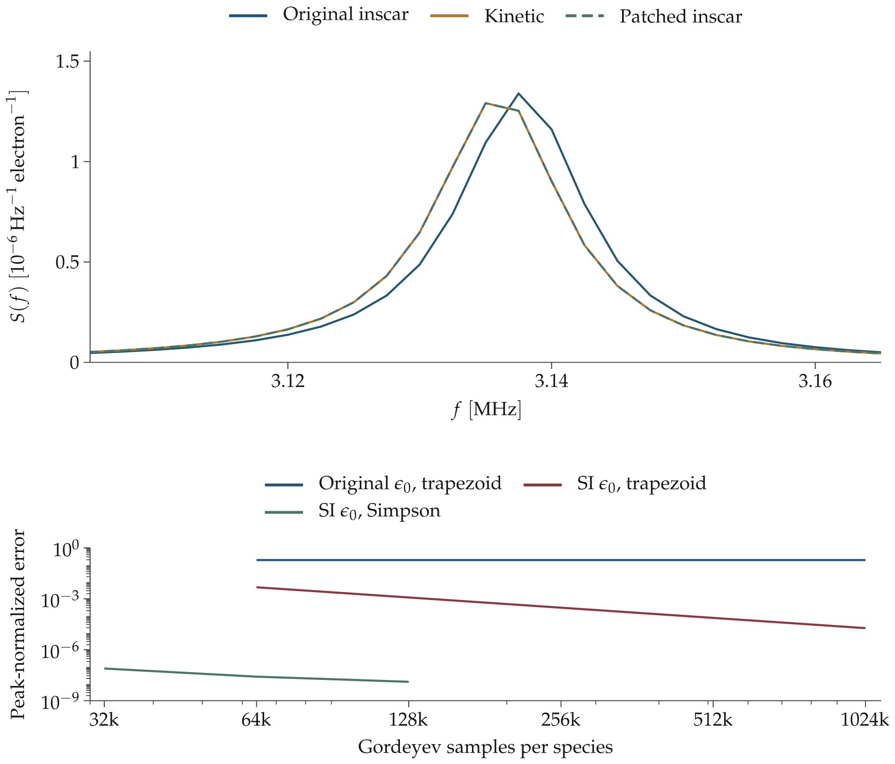

# inscar accuracy follow-up

Increasing Gordeyev resolution helps, but cannot remove the discrepancy caused by the original approximate permittivity. Using standard SI permittivity and optional nonuniform Simpson quadrature brings all five compatible Maxwellian cases below the 10⁻⁶ threshold. No plasma parameters, amplitudes or frequency shifts were fitted.

**Proposed upstream change:** [inscar PR #537](https://github.com/engeir/inscar/pull/537), [tested commit](https://github.com/jvierine/inscar/commit/532412a). These are results from the proposed patch, not the pinned upstream release. The original README comparison and HDF5 tables are retained.



Upper panel: positive plasma resonance, with the original 2.5 kHz sampling retained. Patched inscar uses standard permittivity and Simpson quadrature with 128,001 samples per species. Lower panel: error against Kinetic while varying only the quadrature sample count at fixed integration cutoff. Errors cover both original ±2–4 MHz windows, including 1,602 frequency samples.

## Full-grid results

All five cases use the original prescribed plasma parameters and frequency grids. The metric is `max(abs(A-B))/max(max(abs(A)),max(abs(B)))`. Grid sensitivity compares 64,001 with 128,001 samples at fixed cutoff; cutoff sensitivity independently increases the cutoff by 20% at 128,001 samples.

| Case | Original upstream error | Patched Simpson error | Grid sensitivity | Cutoff sensitivity |
|---|---:|---:|---:|---:|
| F region, 440.2 MHz | 9.810e-05 | 9.884e-14 | 7.756e-14 | 6.872e-14 |
| F region, 930 MHz | 3.742e-04 | 1.439e-13 | 1.505e-13 | 7.621e-14 |
| Magnetic field, 42° from B | 1.118e-05 | 1.182e-13 | 9.175e-14 | 4.351e-14 |
| Magnetic field, 85° from B | 1.023e-05 | 5.795e-14 | 6.478e-14 | 3.465e-14 |
| Electron plasma lines | 1.926e-01 | 1.300e-08 | 3.734e-08 | 1.881e-08 |

## Resolution and constant effects

The original permittivity, `1e-9/(36*pi)`, is approximately 0.138% below `scipy.constants.epsilon_0`. The plasma-line denominator amplifies this difference. The paired constant experiments reuse identical Gordeyev responses, changing only the susceptibility prefactor through the public hook.

| Plasma-line quadrature | Samples per species | Original permittivity error | SI permittivity error |
|---|---:|---:|---:|
| trapezoid | 64,001 | 1.912e-01 | 4.801e-03 |
| trapezoid | 128,001 | 1.923e-01 | 1.204e-03 |
| trapezoid | 256,001 | 1.926e-01 | 3.011e-04 |
| trapezoid | 512,001 | 1.927e-01 | 7.528e-05 |
| trapezoid | 1,024,001 | 1.927e-01 | 1.881e-05 |
| simpson | 32,001 | 1.927e-01 | 7.864e-08 |
| simpson | 64,001 | 1.927e-01 | 2.604e-08 |
| simpson | 128,001 | 1.927e-01 | 1.300e-08 |

## Numerical controls

The existing public `Particle` controls are `gordeyev_size` (number of samples), `gordeyev_upper_lim` (time cutoff) and `gordeyev_exp` (sampling-grid exponent). `Parameters.frequency_size` controls the output frequency grid, not Gordeyev resolution. The patch adds `gordeyev_method="simpson"`, retaining `"trapezoid"` as the default.

For these runs, each species uses exponent 3 and time cutoff `15/(abs(k)*sqrt(kB*T/m)*abs(cos(theta)))`; the cutoff check substitutes 18 for 15. The removable DC limit uses 10⁻⁴ Hz, as in the existing adapter. Zero field is represented by parallel geometry with a positive dummy field, whose perpendicular contribution vanishes exactly.

Enger’s [thesis](https://hdl.handle.net/10037/19542), §§4.1 and 4.3, discusses Simpson quadrature, nonuniform sampling, and increasing Gordeyev sampling from 80,000 to 800,000 points. The current pinned implementation uses trapezoidal quadrature. The new Simpson option follows that numerical approach; the permittivity correction is independently necessary for agreement at this threshold.

These finite-grid sensitivity checks are not error bounds or validation of arbitrary distributions. Only the five previously supported Maxwellian cases were rerun; mixture and neutral-BGK limitations remain.

## Reproduction and validation

The [HDF5 experiment](diagnostics/inscar_accuracy.h5) includes the full arrays, numerical settings, runtime versions, source commits and hashes. The [vector figure](figures/inscar_accuracy.svg) is also available.

Use a clean checkout of the tested PR commit. `PYTHONPATH` selects it without replacing the original pinned installation:

```sh
PYTHONPATH=/path/to/inscar/src NUMBA_NUM_THREADS=1 NUMBA_CACHE_DIR=.cache/accuracy-run-cache conda run -n base python inscar_accuracy.py
cargo run --release --locked --manifest-path plots/Cargo.toml --bin inscar_accuracy -- .
conda run -n base python inscar_accuracy_report.py
```

The report command verifies grid/parameter identity, preservation of upstream spectra, all saved error metrics and independent refinement checks. Upstream tests: 15 passed with a fresh Numba cache; the nine new accuracy tests also pass in repeated processes with a populated cache. A pre-existing cached velocity-integral crash reproduces on the unmodified upstream in this macOS/Python 3.13 environment and is documented in the PR.
