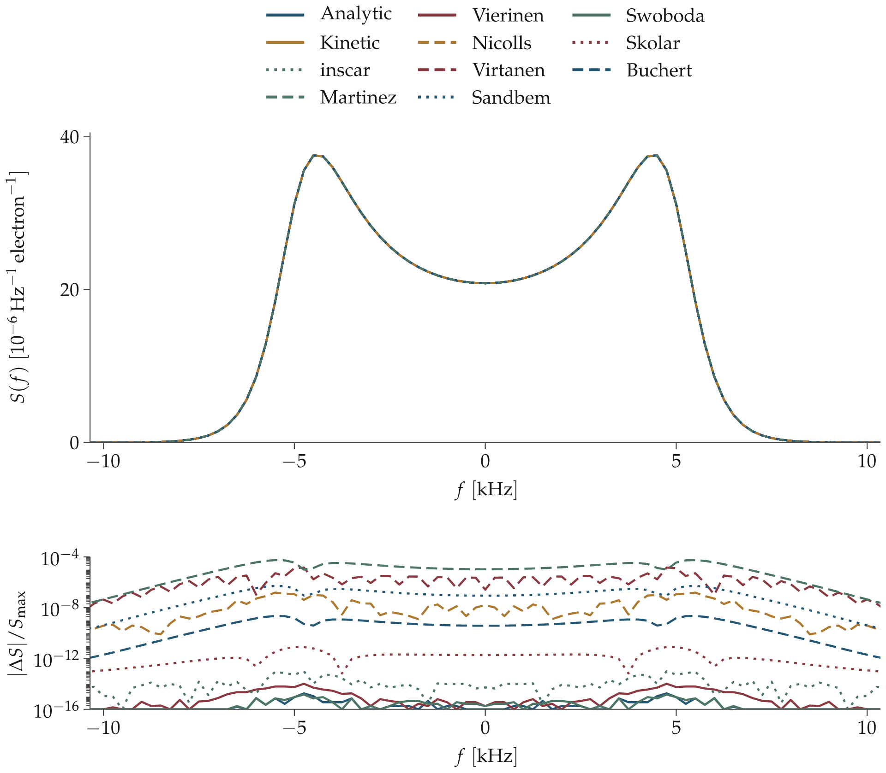
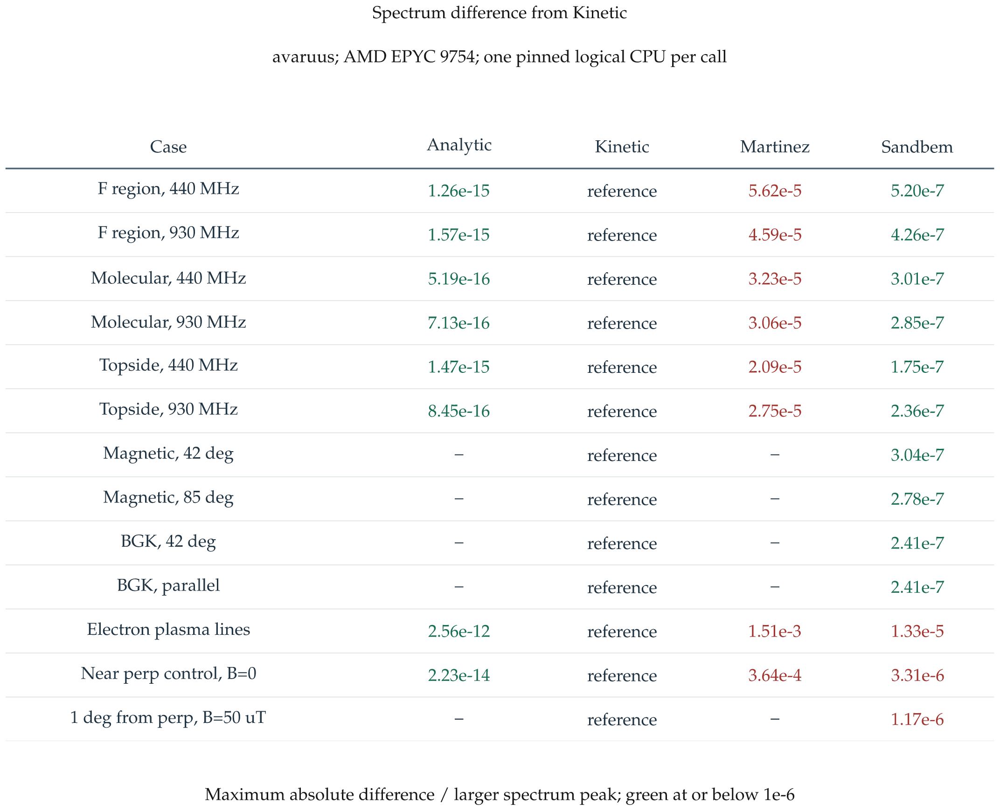
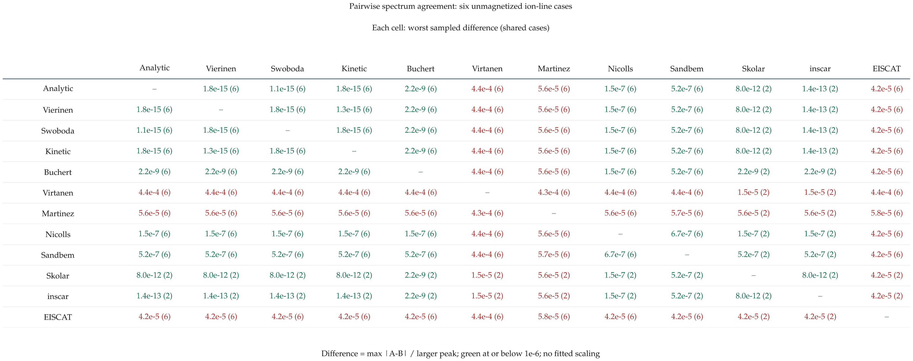
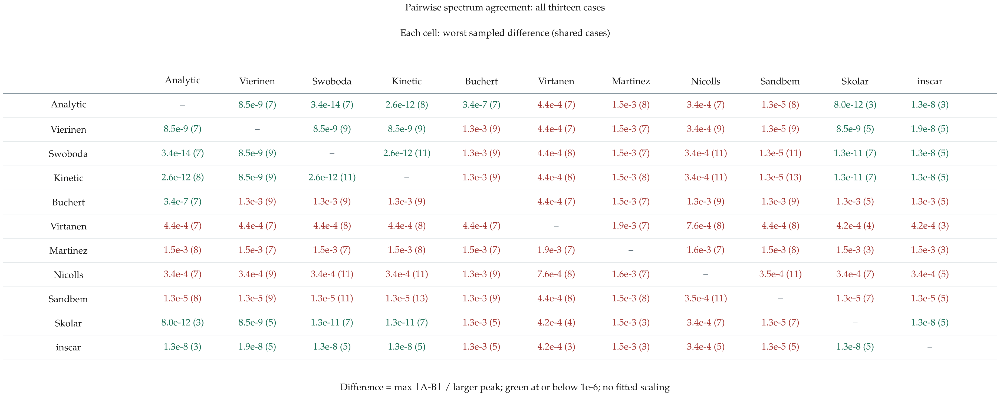
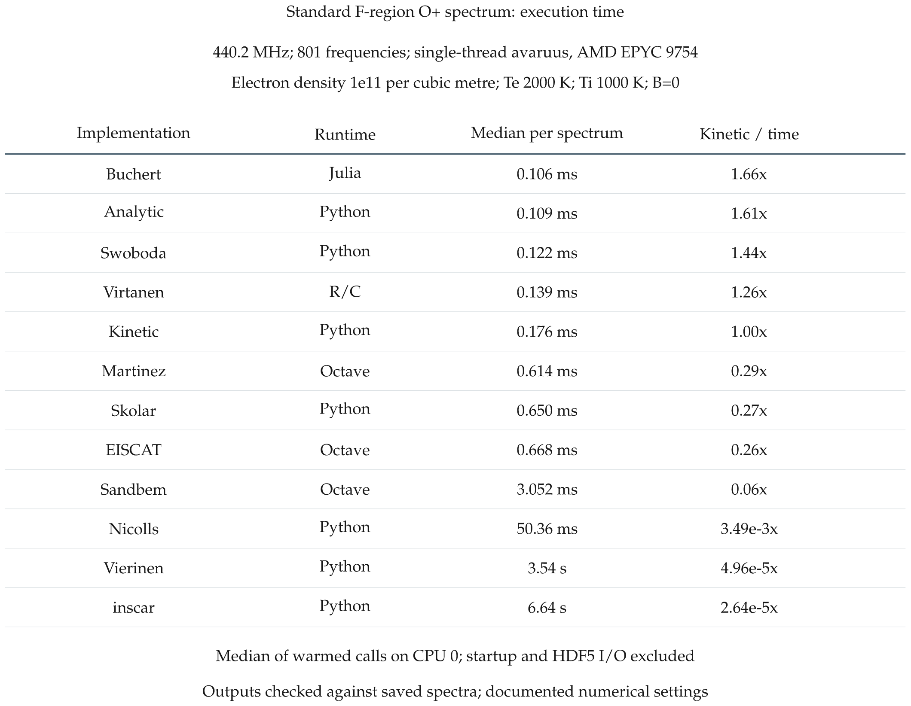
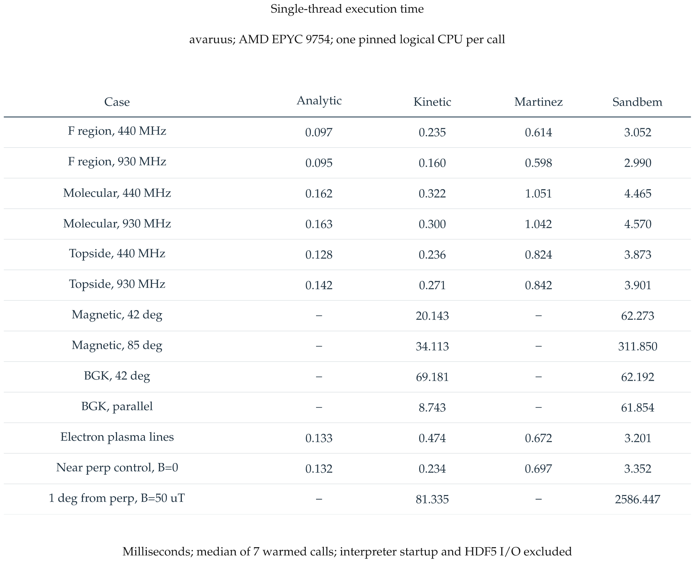
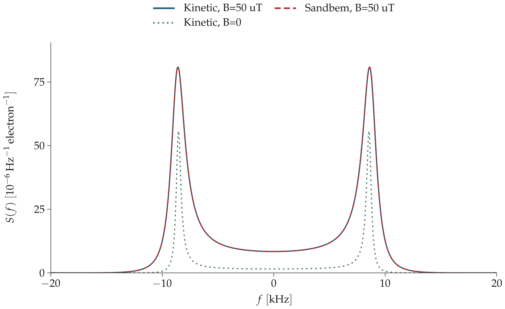

# ISR spectrum validation

This is an effort to document and cross-validate different open source incoherent scatter radar spectrum calculation programs and provide a way for anyone implemented such a program to be able to compare their result with others -- without trying to get the numbers out of a plot in a scientific article.

[](figures/f_region_440.2MHz.svg)

**F-region comparison at 440.2 MHz.** O⁺ plasma with ne = 10¹¹ m⁻³, Te = 2000 K and Ti = 1000 K, without magnetic field, collisions or drift. The upper panel overlays all twelve evaluated implementations; the lower panel shows their absolute differences from Kinetic, divided by its peak. Nearly coincident spectra are distinguished by the residuals. [Case details](COMPARISON_RESULTS.md#f-region-4402-mhz).

Twelve implementations evaluated across eleven prescribed Maxwellian tests. The Martinez, Sandbem and EISCAT GUISDAP MATLAB implementations run through GNU Octave. Each test has a spectrum overlay and a residual panel. Coverage differs where an adapter does not support the prescribed physics.

[Six ion-line tests and plots](COMPARISON_RESULTS.md) · [Five magnetic, collision and plasma-line tests and plots](EXTENDED_RESULTS.md)

## Test your own code

Start with the F-region case shown above. You only need Python 3, NumPy and h5py to compare results; the reference data are included.

**1. Download the repository and install the two comparison dependencies** in your usual Python environment:

```sh
git clone https://github.com/jvierine/isr_spec_validation.git
cd isr_spec_validation
python -m pip install numpy h5py
```

**2. Open [check_my_spectrum.py](check_my_spectrum.py) and replace the `raise NotImplementedError(...)` line in `my_spectrum()` with a call to your calculator.** Use these inputs:

- Radar: 440.2 MHz, monostatic backscatter
- Electron density: 10¹¹ m⁻³
- Temperatures: Te = 2000 K; Ti = 1000 K
- Ions: 100% O⁺, mass = 16 atomic mass units
- Distribution: isotropic Maxwellian
- Magnetic field, collision rates and drifts: all zero

The helper supplies 801 frequencies from −100,000 to +100,000 Hz. Return the total spectrum (ion + electron terms) on that exact grid, **per electron per Hz**. Divide density-scaled output by ne; multiply a PSD per radian/s by 2π to convert it to per Hz. Do not normalize the peak or area.

**3. Run the comparison:**

```sh
python check_my_spectrum.py
```

It prints **PASS** or **FAIL** and the maximum difference divided by the larger spectrum peak. The tolerance is 10⁻⁶. A pass applies to this case and grid; it is a starting check, not a validation of every regime.

Using R, MATLAB, Julia or another language? Run your calculator there and replace the same function with code that reads your output spectrum from HDF5; a two-line example is included in the helper. The supplied grid is `frequency_hz` in [the reference file](tables/expanded/f_region_440.2MHz.h5). For more cases, see the [ion-line](COMPARISON_RESULTS.md) and [extended](EXTENDED_RESULTS.md) parameters and data.

## Coverage and measured agreement

The threshold is 10⁻⁶. Errors use `max(abs(A-B))/max(max(abs(A)),max(abs(B)))`, with fixed physical unit conversions and no fitted scaling. Kinetic is the plotting reference, not an assertion of ground truth. Results apply only to the cases and frequency samples evaluated.



[Vector agreement table](figures/octave_agreement.svg) · [Measured HDF5](tables/octave/)

**inscar version:** these tests use [commit 532412a](https://github.com/jvierine/inscar/commit/532412a280a7e3373595fbaff763bcf12471622e) from [PR #537](https://github.com/engeir/inscar/pull/537), with standard SI permittivity and Simpson integration at 128,001 samples per species. Grid resolution, time cutoff and the DC limit are checked separately. The [accuracy study](INSCAR_ACCURACY.md) retains the earlier upstream results for comparison.

## Pairwise agreement across all implementations

Every cell shows the worst sampled-spectrum difference and the number of cases shared by that pair. The metric uses the larger spectrum peak; there is no fitted scaling.



[Vector ion-line matrix](figures/pairwise_ionline.svg)



[Vector all-case matrix](figures/pairwise_all.svg) · [Machine-readable pairwise summary](tables/pairwise_summary.h5)

The thirteen-case matrix includes a 1° from perpendicular-to-B test and its unmagnetized control. Cells have different shared-case counts because implementations have different physical scope. EISCAT GUISDAP and the Virtanen R/C implementation share GUISDAP ancestry.

## Standard F-region O⁺ spectrum speed

All twelve implementations were timed on avaruus for the same 440.2 MHz, 801-frequency F-region case. Each call used one pinned logical CPU, with startup, compilation and HDF5 I/O excluded. The R/C result uses the median of seven 100-call batches; the other results use medians of seven warmed calls. Each output was checked against its saved comparison spectrum. Different numerical algorithms and refinement settings affect these times, so speed alone does not measure accuracy.



[Vector speed table](figures/f_region_speed.svg) · [Times and provenance in HDF5](tables/speed_standard_f_region.h5) · [Reproduce the benchmark](NEW_CODES.md#standard-f-region-speed-benchmark)

## Timing across cases

The thirteen-case timing table covers Analytic, Kinetic, Martinez and Sandbem. Those results are medians of seven warmed calls on one pinned avaruus logical CPU; startup and HDF5 I/O are excluded.



[Vector timing table](figures/octave_timing.svg)

## Near-perpendicular magnetic edge case

At 89° from B, the spectrum has narrow enhanced features near the lower-hybrid frequency. The frequency-grid data and B=0 control are retained in HDF5.



[Vector edge-case figure](figures/near_perp_1deg.svg) · [Magnetic HDF5](tables/octave/near_perp_1deg_lower_hybrid.h5) · [Unmagnetized control](tables/octave/near_perp_unmagnetized_control.h5)

[HDF5 arrays and pairwise matrices](tables/expanded/) retain the original grids and plasma parameters. The [original four-code data](tables/comparison/) and [original extended data](tables/extended/) remain available, including their earlier refinement checks.

[Reproduce the expanded runs and figures](NEW_CODES.md) · [Original methods](METHODS.md) · [Original four-code adapters](DETAILS.md) · [Catalog and archives](OTHER_CODES.md)
