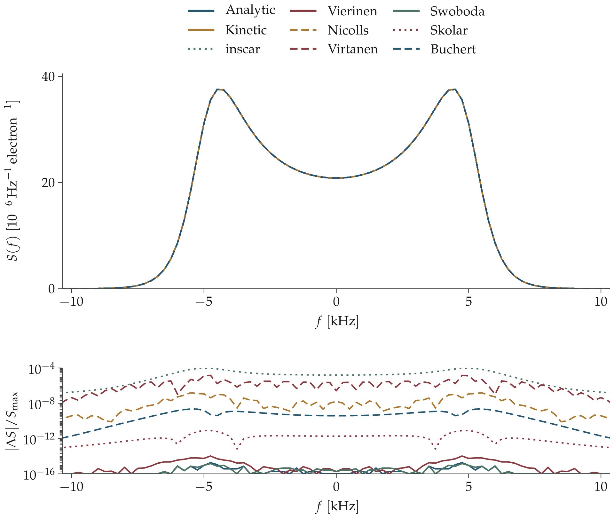

# ISR spectrum validation

This is an effort to document and cross-validate different open source incoherent scatter radar spectrum calculation programs and provide a way for anyone implemented such a program to be able to compare their result with others -- without trying to get the numbers out of a plot in a scientific article.

[](figures/f_region_440.2MHz.svg)

**F-region comparison at 440.2 MHz.** O⁺ plasma with ne = 10¹¹ m⁻³, Te = 2000 K and Ti = 1000 K, without magnetic field, collisions or drift. The upper panel overlays all nine evaluated implementations; the lower panel shows their absolute differences from Kinetic, divided by its peak. Nearly coincident spectra are distinguished by the residuals. [Case details](COMPARISON_RESULTS.md#f-region-4402-mhz).

Nine implementations evaluated across eleven prescribed Maxwellian tests. Each test has a spectrum overlay and a residual panel. Martinez and Sandbem are listed but were not run after MATLAB license failures; Virtanen uses the working R/C implementation.

[Six ion-line tests and plots](COMPARISON_RESULTS.md) · [Five magnetic, collision and plasma-line tests and plots](EXTENDED_RESULTS.md)

## Test your own code

Start with the F-region case shown above. You only need Python 3, NumPy and h5py to compare results; the reference data are included.

**1. Download the repository and install the two comparison dependencies** in your usual Python environment:

```sh
git clone https://github.com/jvierine/isr_spec_validation.git
cd isr_spec_validation
python -m pip install numpy h5py
```

**2. Open [check_my_spectrum.py](check_my_spectrum.py) and replace the `raise NotImplementedError(...)` line in `my_spectrum()` with a call to your calculator.** Use these inputs:

| Parameter | Value |
|---|---|
| Radar | 440.2 MHz, monostatic backscatter |
| Electron density | 10¹¹ m⁻³ |
| Temperatures | Te = 2000 K; Ti = 1000 K |
| Ions | 100% O⁺, mass = 16 atomic mass units |
| Distribution | Isotropic Maxwellian |
| Magnetic field, collision rates and drifts | All zero |

The helper supplies 801 frequencies from −100,000 to +100,000 Hz. Return the total spectrum (ion + electron terms) on that exact grid, **per electron per Hz**. Divide density-scaled output by ne; multiply a PSD per radian/s by 2π to convert it to per Hz. Do not normalize the peak or area.

**3. Run the comparison:**

```sh
python check_my_spectrum.py
```

It prints **PASS** or **FAIL** and the maximum difference divided by the larger spectrum peak. The tolerance is 10⁻⁶. A pass applies to this case and grid; it is a starting check, not a validation of every regime.

Using R, MATLAB, Julia or another language? Run your calculator there and replace the same function with code that reads your output spectrum from HDF5; a two-line example is included in the helper. The supplied grid is `frequency_hz` in [the reference file](tables/expanded/f_region_440.2MHz.h5). For more cases, see the [ion-line](COMPARISON_RESULTS.md) and [extended](EXTENDED_RESULTS.md) parameters and data.

## Coverage and measured agreement

The threshold is 10⁻⁶. Errors use `max(abs(A-B))/max(max(abs(A)),max(abs(B)))`, with fixed physical unit conversions and no fitted scaling. Kinetic is the plotting reference, not an assertion of ground truth. Results apply only to the cases and frequency samples evaluated.

| Code | Cases evaluated | Worst difference from Kinetic | Worst case |
|---|---:|---:|---|
| Analytic | 7/11 | 🟩 2.56e-12 | Electron plasma lines |
| Vierinen | 9/11 | 🟩 8.54e-09 | Electron plasma lines |
| Swoboda | 11/11 | 🟩 2.58e-12 | Electron plasma lines |
| Kinetic | 11/11 | reference | F region, 440.2 MHz |
| Buchert | 9/11 | 🟥 1.31e-03 | Magnetic field, 85° from B |
| Virtanen | 8/11 | 🟥 4.39e-04 | Topside, 440.2 MHz |
| Nicolls | 11/11 | 🟥 3.41e-04 | Electron plasma lines |
| Skolar | 7/11 | 🟩 1.33e-11 | Magnetic field, 42° from B |
| inscar | 5/11 | 🟩 1.30e-08 | Electron plasma lines |
| Martinez | 0/11 | not run | MATLAB execution cancelled |
| Sandbem (ISRTS) | 0/11 | not run | MATLAB execution cancelled |

**inscar version:** these tests use [commit 532412a](https://github.com/jvierine/inscar/commit/532412a280a7e3373595fbaff763bcf12471622e) from [PR #537](https://github.com/engeir/inscar/pull/537), with standard SI permittivity and Simpson integration at 128,001 samples per species. Grid resolution, time cutoff and the DC limit are checked separately. The [accuracy study](INSCAR_ACCURACY.md) retains the earlier upstream results for comparison.

## Baseline pairwise agreement

Worst error over the six unmagnetized ion-line tests. Each cell includes the number of shared cases; Skolar and inscar support the two single-ion cases in this adapter.

| Code | Analytic | Vierinen | Swoboda | Kinetic | Buchert | Virtanen | Nicolls | Skolar | inscar |
|---|---:|---:|---:|---:|---:|---:|---:|---:|---:|
| Analytic | — | 🟩 9.58e-11 (6) | 🟩 1.14e-15 (6) | 🟩 1.80e-15 (6) | 🟩 2.23e-09 (6) | 🟥 4.39e-04 (6) | 🟩 1.55e-07 (6) | 🟩 7.97e-12 (2) | 🟩 1.44e-13 (2) |
| Vierinen | 🟩 9.58e-11 (6) | — | 🟩 9.58e-11 (6) | 🟩 9.58e-11 (6) | 🟩 2.23e-09 (6) | 🟥 4.39e-04 (6) | 🟩 1.55e-07 (6) | 🟩 7.97e-12 (2) | 🟩 1.67e-13 (2) |
| Swoboda | 🟩 1.14e-15 (6) | 🟩 9.58e-11 (6) | — | 🟩 1.80e-15 (6) | 🟩 2.23e-09 (6) | 🟥 4.39e-04 (6) | 🟩 1.55e-07 (6) | 🟩 7.97e-12 (2) | 🟩 1.44e-13 (2) |
| Kinetic | 🟩 1.80e-15 (6) | 🟩 9.58e-11 (6) | 🟩 1.80e-15 (6) | — | 🟩 2.23e-09 (6) | 🟥 4.39e-04 (6) | 🟩 1.55e-07 (6) | 🟩 7.97e-12 (2) | 🟩 1.44e-13 (2) |
| Buchert | 🟩 2.23e-09 (6) | 🟩 2.23e-09 (6) | 🟩 2.23e-09 (6) | 🟩 2.23e-09 (6) | — | 🟥 4.39e-04 (6) | 🟩 1.52e-07 (6) | 🟩 2.23e-09 (2) | 🟩 2.23e-09 (2) |
| Virtanen | 🟥 4.39e-04 (6) | 🟥 4.39e-04 (6) | 🟥 4.39e-04 (6) | 🟥 4.39e-04 (6) | 🟥 4.39e-04 (6) | — | 🟥 4.39e-04 (6) | 🟥 1.46e-05 (2) | 🟥 1.46e-05 (2) |
| Nicolls | 🟩 1.55e-07 (6) | 🟩 1.55e-07 (6) | 🟩 1.55e-07 (6) | 🟩 1.55e-07 (6) | 🟩 1.52e-07 (6) | 🟥 4.39e-04 (6) | — | 🟩 1.55e-07 (2) | 🟩 1.55e-07 (2) |
| Skolar | 🟩 7.97e-12 (2) | 🟩 7.97e-12 (2) | 🟩 7.97e-12 (2) | 🟩 7.97e-12 (2) | 🟩 2.23e-09 (2) | 🟥 1.46e-05 (2) | 🟩 1.55e-07 (2) | — | 🟩 8.02e-12 (2) |
| inscar | 🟩 1.44e-13 (2) | 🟩 1.67e-13 (2) | 🟩 1.44e-13 (2) | 🟩 1.44e-13 (2) | 🟩 2.23e-09 (2) | 🟥 1.46e-05 (2) | 🟩 1.55e-07 (2) | 🟩 8.02e-12 (2) | — |

[HDF5 arrays and pairwise matrices](tables/expanded/) retain the original grids and plasma parameters. The [original four-code data](tables/comparison/) and [original extended data](tables/extended/) remain available, including their earlier refinement checks.

[Reproduce the expanded runs and figures](NEW_CODES.md) · [Original methods](METHODS.md) · [Original four-code adapters](DETAILS.md) · [Catalog and archives](OTHER_CODES.md)
